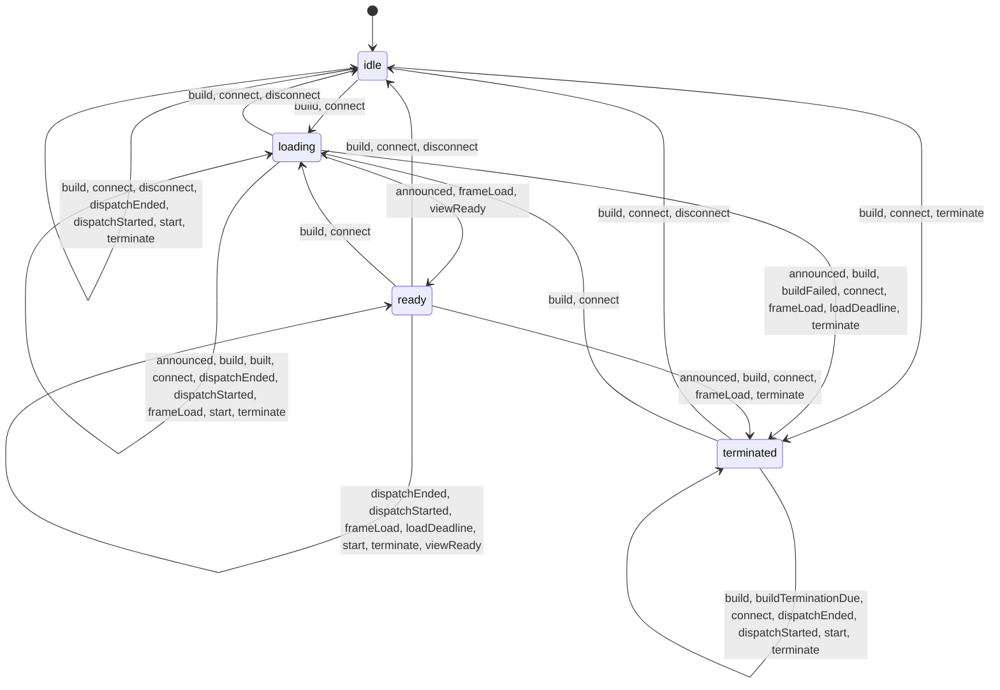

# Architecture

How `web-sandbox` is put together, on one page. It is the map; the [API reference](docs/API.md) is the surface, and the
decision records say why each part is built the way it is: [ADR-002](docs/ADR-002-host-guest-broker.md) (the broker),
[ADR-003](docs/ADR-003-lifecycle-and-liveness.md) (lifecycle and liveness), [ADR-004](docs/ADR-004-files-as-blob-urls.md)
(files), [ADR-005](docs/ADR-005-strict-mode.md) (strict mode), [ADR-006](docs/ADR-006-fetch-bridge.md) (the fetch bridge),
[ADR-007](docs/ADR-007-typed-origins.md) (typed origins), [ADR-008](docs/ADR-008-sealed-mode.md) (sealed mode, the
default) and [ADR-009](docs/ADR-009-network-modes-build-flag.md) (the other modes behind a build flag). What the design defends, and what it leaves to the
embedder and the browser, is the [threat model](docs/THREAT-MODEL.md).

The tables below are generated from the values the code declares (`bun run docs:gen`), so they cannot drift from it.
Each section of prose says which declarations it describes; when one changes, `bun run docs:check` fails until the
section has been read (see [CONTRIBUTING](CONTRIBUTING.md#generated-docs-and-their-markers)).

## Modes and realms

<!-- describes: realms sig:bfea -->

Guest content never runs in the host page's realm. The element builds a **wrapper** frame it owns (`frame-src 'none'`,
an inert base URL, no referrer) and puts the guest inside it, in a frame with an opaque origin and a Content-Security-Policy
that is one fixed template per mode, to which the embedder adds only exact origins ([ADR-007](docs/ADR-007-typed-origins.md)).
What differs between the modes is which realm the guest's code runs in, and whether it has a network:

- **sealed** (the default): strict mode's view and worker, with no network
  ([below](#sealed-mode-strict-mode-with-no-network), [ADR-008](docs/ADR-008-sealed-mode.md)).
The package as built by default holds sealed mode alone; the three modes below are the **network modes**, which are
in the build only with its flag on ([Two builds](#two-builds-the-network-modes-behind-a-flag)):

- **strict**: in a worker. The frame around it, the view, runs one script, the library's own, admitted by its hash, and
  draws what the worker renders. No guest script ever runs in a document, and the worker runs no string as code. Named
  with `mode: 'strict'`; it adds the network options, `origins` and `fetchBridge`, and keeps `scriptUnsafe` for testing.
- **cooperative**: in the guest document, for content that cooperates, within a frozen list of documented limits.
- **worker**: in a worker spawned by a frame with no guest markup. Frozen, to be folded into strict mode.

In every mode but sealed, with `fetchBridge`, the element adds one more frame of its own beside the wrapper: the **bridge frame**,
hidden, with an opaque origin and no guest code, which makes each request the host decided, so no Service Worker or
`fetch` wrapper of the host page applies to it ([ADR-006](docs/ADR-006-fetch-bridge.md)).

Every bootstrap that runs in a document of the library's (the view's and the bridge frame's, the cooperative guest's,
worker mode's frame's) first checks that the document is the one the library built: an opaque origin, `about:srcdoc`,
the base `about:blank`, and not cross-origin isolated (`src/lib/environment-check.ts`, S74). If a check fails the bootstrap stays inert, tells the host
page, and the element ends the sandbox with the reason of that check.

Each realm is declared once, with the functions the library stringifies into it (a realm cannot import from the host's
bundle, so those functions close over nothing, and the tests scan their text).

<!-- generated:begin realms -->
| Realm | What it is | Guest code | Code stringified into it | Channels |
| :--- | :--- | :--- | :--- | :--- |
| `host` | The host page's window: the element, its listeners, and the host end of every port. | no | — | `announcement`, `logic-port`, `view-port`, `view-init`, `bridge-init`, `bridge-port` |
| `wrapper` | The sandbox frame's document (frame-documents.ts): it holds the guest frame or the strict view, and runs no script. | no | — | — |
| `cooperative` | Cooperative mode's guest document: the bootstrap, then the guest's markup and scripts. | yes | `inSandboxScript`, `requestGate`, `createBroker`, `createSizeOf`, `inSandboxFiles`, `inSandboxImportMap`, `inSandboxMarkup`, `checkSandboxEnvironment` | `announcement`, `logic-port` |
| `worker-frame` | Worker mode's frame document: it spawns the guest's worker and announces its port; no guest code or markup. | no | `workerBootstrap`, `checkSandboxEnvironment` | `announcement`, `worker` |
| `worker` | Worker mode's guest worker: the globals allowlist and the bootstrap, then the guest's code. | yes | `inSandboxScript`, `requestGate`, `createBroker`, `createSizeOf`, `inSandboxFiles`, `keepOnlyWorkerGlobals` | `logic-port`, `worker` |
| `view` | Strict mode's view document: it renders the guest's markup, spawns the guest's worker, and runs no guest code. | no | `inSandboxFiles`, `inSandboxView`, `sanitizeRender`, `viewBudget`, `cssLoadBound`, `cssReferences`, `withKeptReferences`, `keepsUrl`, `styleMarkup`, `viewInputOutbox`, `viewControlNames`, `isStyleProperty`, `checkSandboxEnvironment` | `announcement`, `view-init`, `view-port`, `render-port`, `worker` |
| `strict-worker` | Strict mode's guest worker: the scope check, the globals allowlist, the bootstrap, the prelude and the code-from-string refusal, then the guest's entry. | yes | `inSandboxScript`, `requestGate`, `createBroker`, `createSizeOf`, `inSandboxFiles`, `keepOnlyWorkerGlobals`, `removeSecureContextOnly`, `assertEntryScoped`, `inStrictWorker`, `refuseCodeFromStrings`, `isStyleProperty` | `logic-port`, `render-port`, `worker` |
| `bridge-frame` | The fetch bridge's frame (bridge-frame.ts): a hidden frame of the element's with an opaque origin, which makes every request the host decided; no guest code or markup, and the guest has no handle on it. | no | `checkSandboxEnvironment`, `inBridgeFrame` | `announcement`, `bridge-init`, `bridge-port` |
<!-- generated:end -->

<!-- generated:begin stringified -->
| Function | Module | Realms |
| :--- | :--- | :--- |
| `inSandboxScript` | `src/lib/in-sandbox-script.ts` | `cooperative`, `worker`, `strict-worker` |
| `requestGate` | `src/lib/request-gate.ts` | `cooperative`, `worker`, `strict-worker` |
| `createBroker` | `src/lib/rpc.ts` | `cooperative`, `worker`, `strict-worker` |
| `createSizeOf` | `src/lib/structured-size.ts` | `cooperative`, `worker`, `strict-worker` |
| `inSandboxFiles` | `src/lib/in-sandbox-files.ts` | `cooperative`, `worker`, `strict-worker`, `view` |
| `inSandboxImportMap` | `src/lib/in-sandbox-files.ts` | `cooperative` |
| `inSandboxMarkup` | `src/lib/in-sandbox-files.ts` | `cooperative` |
| `keepOnlyWorkerGlobals` | `src/lib/worker-globals.ts` | `worker`, `strict-worker` |
| `removeSecureContextOnly` | `src/lib/worker-globals.ts` | `strict-worker` |
| `workerBootstrap` | `src/lib/worker-bootstrap.ts` | `worker-frame` |
| `assertEntryScoped` | `src/lib/in-sandbox-view.ts` | `strict-worker` |
| `inStrictWorker` | `src/lib/in-sandbox-view.ts` | `strict-worker` |
| `refuseCodeFromStrings` | `src/lib/code-from-strings.ts` | `strict-worker` |
| `inSandboxView` | `src/lib/in-sandbox-view.ts` | `view` |
| `sanitizeRender` | `src/lib/in-sandbox-view.ts` | `view` |
| `viewBudget` | `src/lib/in-sandbox-view.ts` | `view` |
| `cssLoadBound` | `src/lib/in-sandbox-view.ts` | `view` |
| `cssReferences` | `src/lib/css-references.ts` | `view` |
| `withKeptReferences` | `src/lib/css-references.ts` | `view` |
| `keepsUrl` | `src/lib/css-references.ts` | `view` |
| `styleMarkup` | `src/lib/style-markup.ts` | `view` |
| `viewInputOutbox` | `src/lib/in-sandbox-view.ts` | `view` |
| `viewControlNames` | `src/lib/in-sandbox-view.ts` | `view` |
| `isStyleProperty` | `src/lib/in-sandbox-view.ts` | `view`, `strict-worker` |
| `checkSandboxEnvironment` | `src/lib/environment-check.ts` | `cooperative`, `worker-frame`, `view`, `bridge-frame` |
| `inBridgeFrame` | `src/lib/in-bridge-frame.ts` | `bridge-frame` |
<!-- generated:end -->

## Strict mode: the worker and the view

<!-- describes: realms, channel:view-port, channel:render-port, channel:view-init sig:bfeab45f42cb49d7 -->

Strict mode splits what a guest needs into two realms that cannot run each other's code. The **worker** has the guest's
logic and no DOM; it keeps only the globals an allowlist names, so a network API an engine forgot to police does not exist
there (sealed mode's has no `fetch`, `XMLHttpRequest` or `WebSocket` at all; strict mode keeps them behind the request gate). The **view** has the DOM and none of the guest's code: it cleans the markup the worker asks to render (whatever it
keeps loads without credentials: [API.md](docs/API.md#the-views-loads)), moves it into its document, applies the guest's styles through the CSSOM (never as an inline style, which the host page's policy would check: [API.md](docs/API.md#guest-styles)), names the guest's form controls itself and forwards a control's value only as the user entered it, so the browser's autofill reaches no guest ([API.md](docs/API.md#forms-and-the-browsers-autofill)), and enforces the view's budgets. They talk on the render port, which the host is not on, so the host's own code never
carries a render (the view's work still runs on the host page's thread where the browser places the view there, and is
bounded: [API.md](docs/API.md#the-views-cost-to-the-host-page)). The host talks to each on a port of its own, and watches the view for liveness always and
the worker's with `watchdogTimeout`. The guest can therefore draw but not script, and a flood of drawing is bounded where
it is applied. See [ADR-005](docs/ADR-005-strict-mode.md) and, for the render path,
[ADR-002](docs/ADR-002-host-guest-broker.md).

## Sealed mode: strict mode with no network

<!-- describes: csp:sealed, options, inherited-context, budgets:channels sig:818ebf36e1937e47 -->

Sealed mode, the default (no `mode`, or `mode: 'sealed'`), is strict mode's view and worker with no network
([research 24](docs/research/24_sealed_mode/README.md), [ADR-008](docs/ADR-008-sealed-mode.md)). It is not strict mode
with its network options left empty: the sealed path never reaches the code that would read or open a network, so there is nothing to leave empty.

- **The config.** `origins` and `fetchBridge` are not sealed options: a sealed config that names either, with the mode
  written or left out, is refused whole, with its reason, and so is one that sets `scriptUnsafe: true`; the network
  options' rules never run in sealed mode (`readIn`, `src/lib/config-schema.ts`). Those two rules are
  the only ones that read the host page (its origin and its site, from `src/lib/host-site.ts`, through `readHostPage` in
  `src/host.ts`, which `normaliseConfig` calls only when such a rule asks), so a sealed `start()` reads nothing of it.
- **The build.** `_prepareBuild` turns to sealed mode's own path, `_prepareSealedFrame`, before anything of the network
  is asked: no `_reach` (the host page's policy is applied to nothing), no bridge frame, no request gate and no list for one. The view
  and its worker are strict mode's (`_prepareViewFrame`), under `sealedViewPolicy`, whose input has no field an origin
  could come from (below: with no files; registered files and guest writes add `blob:` for their kind of load, and
  `connect-src` stays `'none'`).
- **The worker.** It has no `fetch`, `XMLHttpRequest` or `WebSocket`, nor the two `XMLHttpRequest` helper interfaces:
  its allowlist (`SEALED_WORKER_GLOBALS`, `src/lib/worker-globals.ts`) is strict mode's without the network names
  (`NETWORK_WORKER_GLOBALS`), which the worker's first statement deletes, so `typeof fetch === 'undefined'`. Its bootstrap
  is given `sealed` and no request gate (a module of the network build, `src/lib/request-gate.ts`): nothing of the sealed
  worker's source names, captures or installs a request maker. `sandboxFetch()` rejects in the guest with
  `FETCH_NOT_ALLOWED` and sends nothing to the host. A guest can still call the reserved method itself
  (`bridge.call('sandbox:fetch')`); the host's handler has no bridge in a sealed build and refuses it with the same code,
  and no request is made. The prelude's last statement puts the library's `EvalError` in place of every code-from-string
  sink (`src/lib/code-from-strings.ts`), and the build refuses an entry that calls `import()`
  (`src/lib/entry-imports.ts`), so nothing the worker does makes the browser check the host page's own policy, which the
  worker inherits with its text and its report endpoints; a violation the browser still raises there is relayed and
  stopped before guest code hears it.
- **The view.** `INIT_VIEW` carries no origins, and every URL the guest writes, in markup, in CSS or in a registered
  stylesheet, is kept only as the one rule for a URL in the view allows (`keepsUrl`, `src/lib/css-references.ts`): a
  registered file's URL the view minted, or a fragment in an SVG reference, so what it shows loads from `blob:`. Its
  parser is never given a `style` attribute or a `<style>` element (`src/lib/style-markup.ts`), and the guest's styles
  are applied through the CSSOM, so the host page's `style-src` checks and reports none of them. Its form controls carry
  names of the view's and `autocomplete="off"`, and it forwards a control's value only as the user entered it, so no store
  of the browser's autofill reaches the guest from a field the user is not in
  ([API.md](docs/API.md#forms-and-the-browsers-autofill)).
- **The host page.** The one value of the page's a sealed build reads is `crossOriginIsolated`, only to refuse (as in
  every mode); `hostContentSecurityPolicy` serves only Trusted Types where the browser has none. Which inherited channels
  remain in sealed mode is the sealed column of the [host page's context](docs/THREAT-MODEL.md#the-host-pages-context),
  and what each channel of guest activity reaches of the network, the sealed column of [Budgets](docs/API.md#budgets).
  What the guest's code and markup can reach of each inherited channel is classified name by name
  ([`SEALED_REACH`](docs/THREAT-MODEL.md#what-a-sealed-guest-can-reach-row-by-row)); the worker has nothing only a
  secure context has, and reads `isSecureContext` as false, so its surface does not depend on the page's URL on any
  engine (`SECURE_CONTEXT_ONLY`, `src/lib/worker-globals.ts`).

`test/unit/sealed-build.test.ts` holds this by construction and by run: the call graph of the sealed path reaches none of
the network code, the host page is never asked, and each check has strict mode with a network as its positive control.

<!-- generated:begin csp-sealed -->
```
default-src 'none'; script-src 'sha256-<bootstrap>'; script-src-attr 'none'; style-src 'unsafe-inline';
img-src 'none'; font-src 'none'; media-src 'none'; connect-src 'none'; worker-src blob:; frame-src 'none';
object-src 'none'; base-uri 'none'; form-action 'none'; manifest-src 'none'
```
<!-- generated:end -->

## Two builds: the network modes behind a flag

<!-- describes: build-flag, build-modules, reason:networkModesOff sig:3eaee5b78ed4 -->

The package is built two ways, chosen by one flag that is off by default ([ADR-009](docs/ADR-009-network-modes-build-flag.md);
`NETWORK_MODES_FLAG`, `src/lib/build-flag.ts`):

<!-- generated:begin builds -->
| Build | How it is built | Entry | Modes | What it has |
| :--- | :--- | :--- | :--- | :--- |
| default (the package as published) | `bun run build:lib` | `src/index.ts` | `sealed` | sealed mode alone; `origins` and `fetchBridge` are refused; 48 modules of `src/` |
| network | `WEB_SANDBOX_NETWORK_MODES=1 bun run build:lib` | `src/network.ts` | `sealed`, `strict`, `cooperative`, `worker` | every mode, with `origins` and `fetchBridge`; 66 modules of `src/` |
<!-- generated:end -->

- **Two entries.** `src/index.ts` is the default build's and `src/network.ts` the network build's; both export
  `src/sealed.ts`, the API every build has. What a build holds is what its entry reaches: every module of `src/` is
  classified once (`BUILD_MODULES`, `src/lib/build-modules.ts`, the Build column of the [module map](#module-map)) as
  sealed mode's, the network modes', or a registry that no build imports, and the default entry reaches sealed mode's
  modules only. No constant is folded and nothing is removed after the fact: the default entry has no import that leads
  to a module of the network modes, so the default bundle cannot hold one. `scripts/build-lib.ts` writes a bundle only if
  the bundler kept code of the build's own modules and no other.
- **One element, and a seam.** The element's class (`src/host.ts`) has sealed mode's build path and everything every
  mode shares. What the network modes add are methods of the element (`NetworkMethods`, `src/lib/network-host.ts`: the
  builds of cooperative and worker mode and of strict mode's network, the fetch bridge's start, the guest frame's
  announcement, `execute()` itself, its frame and its deadline) and four values (`src/lib/network-modes.ts`: the config rules of
  `origins` and `fetchBridge`, the reader of the host page, the detail of an `origins` refusal, the bridge frame's part
  of the hashed bootstrap). The network build's entry installs the methods on the element's prototype and fills the
  slot as it is imported (`src/lib/network-install.ts`); the class calls seven of the methods, each only where the build
  has it (one accessor, null while the slot is empty; the lifecycle's effect looks the method up on the class's
  prototype). In the default build nothing fills the slot and the element has none of the methods.
- **The config.** The schema declares every option, the network ones too (their defaults and modes). In the default
  build grants that name a network mode or option are refused before any option is read
  (`networkModesOffRefusal`, `src/lib/config-schema.ts`): `start()` throws, with a message that names the flag, and no
  rule of a network option exists to run in any mode.
- **The bootstrap.** The hashed script is the view's and, in the network build, the fetch bridge frame's too; the
  default build's has the view alone, so each build has its own `viewScriptHash()`.
- **What is shared stays shared.** The functions stringified into the guest's worker and the view, the broker, the
  lifecycle reducer and the environment's teardown are the same text in both builds. They keep their branches for
  cooperative and worker mode and for strict mode's network, which the default build cannot reach: it stringifies the
  guest's bootstrap for strict mode's worker with `sealed` alone, hands it no request gate (that function is a network
  module's, stringified in by the network build only), and hands the view no network.

`test/unit/default-build.test.ts` holds this: every module is classified, the default entry reaches sealed mode's alone
(at run time, and for a type), no function of a network module is in the default bundle, and the refusal applies nothing.
Each test runs against its build: a unit test of a network mode imports `@src/network`, and an e2e test names its build
(`test.use({ build })`, `test/e2e/fixture.ts`), on a page where a config of the other build's modes throws.

## Channels and frames

<!-- describes: channels, frames sig:37948eea -->

Realms talk on channels, and every message on them is a frame of a declared type. A frame is declared once, with the
channels it may cross, the realms at its ends, and for each field what bounds it. What a frame carries out of a guest
realm or the view is cut, checked or measured before it is posted, and the host checks it again on receipt, so the guest
chooses a value but never its size; so is what the bridge frame carries of a response the guest's target chose. The
stringified code writes the frame types as literals; a test keeps them equal to the declaration.

How a field is bounded:

- **not a string**: a number, a boolean, or nothing of the guest's.
- **constant**: a string of the library's, from a closed set.
- **cut**: a string the guest chose, cut to a fixed length before it is posted.
- **checked**: a value the guest chose, refused past a fixed size before anything is posted.
- **measured**: a snapshot, measured whole against a byte budget before it is posted.
- **host**: the host's own value, sent into a realm; the guest never chose it.

<!-- generated:begin channels -->
| Channel | Kind | Spoken in | What it is for | Frame types |
| :--- | :--- | :--- | :--- | :--- |
| `announcement` | window message | `host`, `cooperative`, `worker-frame`, `view`, `bridge-frame` | A library frame's message to the host page's window, before any port: the guest frame's one announcement (the logic port, or worker mode's refusal), and any bootstrap's refusal of an environment other than the one built. | 2 |
| `logic-port` | MessagePort | `host`, `cooperative`, `worker`, `strict-worker` | The host and the guest: calls both ways, execute(), liveness, and the guest bootstrap's lines and reports. | 9 |
| `view-port` | MessagePort | `host`, `view` | Strict mode: the host and the view, which runs no guest code; the view's check-in, reports and liveness. | 16 |
| `render-port` | MessagePort | `view`, `strict-worker` | Strict mode: the view and the guest's worker; the host is not on this path. | 8 |
| `view-init` | window message | `host`, `view` | Strict mode: the host hands the view its two ports, once per build. | 1 |
| `worker` | worker message | `worker-frame`, `worker`, `view`, `strict-worker` | A frame and the worker it spawned: the worker gets its ports, and worker mode's worker says it started. | 3 |
| `bridge-init` | window message | `host`, `bridge-frame` | The fetch bridge: the host hands the bridge's frame its port, once per build. | 1 |
| `bridge-port` | MessagePort | `host`, `bridge-frame` | The fetch bridge: the host and the bridge's frame, which makes every request the host decided; the guest is not on this path. | 8 |
<!-- generated:end -->

<!-- generated:begin frames -->
| Frame | Route | Fields (what bounds each) | Purpose |
| :--- | :--- | :--- | :--- |
| `SANDBOX_PORT` | `announcement`: cooperative, worker-frame → host | `refused` (constant) | The guest frame's announcement: the logic port, transferred; or why worker mode's worker could not start. |
| `ENVIRONMENT_REFUSED` | `announcement`: cooperative, worker-frame, view, bridge-frame → host | `refused` (constant) | A bootstrap found its document other than the one the library built (environment-check.ts) and stayed inert: the sandbox ends with the reason of the check that failed. No port. |
| `INIT_PORT` | `worker`: worker-frame → worker | — | Worker mode's frame hands its worker the logic port. |
| `WORKER_STARTED` | `worker`: worker → worker-frame | — | Worker mode's worker attached its port: the frame may announce it. |
| `INIT_VIEW` | `view-init`: host → view | `workerSource` (host), `entryDone` (host), `viewFiles` (host), `html` (host), `autoResize` (host), `allowAnimations` (host), `allowAutoplay` (host), `origins` (host) | The host hands the view the logic and view ports, at the wrapper's load, with what the build shows. |
| `INIT_WORKER` | `worker`: view → strict-worker | — | The view hands the guest's worker the logic port and the render port. |
| `EXECUTE` | `logic-port`: host → cooperative, worker, strict-worker | `code` (host) | execute(): code for the guest to run. |
| `PING` | `logic-port`: host → cooperative, worker, strict-worker | `n` (not a string) | A liveness probe of the host's: the watchdog's (n > 0) or workerExecutionTimeout's (n < 0). |
| `PONG` | `logic-port`: cooperative, worker, strict-worker → host | `n` (not a string) | The bootstrap's answer to a PING, before the broker: answering at all is the signal. |
| `RPC_REQ` | `logic-port`: cooperative, worker, strict-worker → host<br>`logic-port`: host → cooperative, worker, strict-worker | `id` (not a string), `method` (checked), `args` (measured) | A call: bridge.call() from the guest, call() from the host. Built by requestFrame only (rpc.ts). |
| `RPC_RES` | `logic-port`: cooperative, worker, strict-worker → host<br>`logic-port`: host → cooperative, worker, strict-worker | `id` (checked), `ok` (not a string), `value` (measured), `error` (cut), `code` (constant) | A call's answer, on the port its request came from. Built by resultFrame and refusalFrame only (rpc.ts). |
| `LOG` | `logic-port`: cooperative, worker, strict-worker → host | `level` (constant), `args` (measured), `own` (not a string) | A console line of the guest's, or one of the relay's own (`own`): sandbox-log. |
| `VIOLATION` | `logic-port`: cooperative, worker, strict-worker → host<br>`view-port`: view → host | `directive` (cut), `blockedURI` (cut), `sourceFile` (cut), `lineNumber` (not a string), `columnNumber` (not a string) | A Content-Security-Policy violation report: violation. Labelled by the port it arrived on in strict mode. |
| `RESIZE` | `logic-port`: cooperative → host<br>`view-port`: view → host | `height` (not a string) | The content's height, for autoResize: from cooperative mode's bootstrap, or strict mode's view. |
| `UNCAUGHT_PAST_BUDGET` | `logic-port`: worker, strict-worker → host<br>`view-port`: view → host | — | The guest raised more uncaught errors and rejections in a second than their budget: the sandbox ends. |
| `VIEW_READY` | `view-port`: view → host | `width` (not a string), `height` (not a string), `stillStyleRefused` (not a string) | The view's check-in, its first frame: the strict build is ready. |
| `VIEW_INITIAL` | `view-port`: view → host | `dropped` (constant) | What the initial view (the configuration's `html`) dropped that the author may not expect: the element warns once from it, and reads no markup itself (BD7:LIM-1). Posted once a build, after the initial render, when it dropped something. |
| `VIEW_PING` | `view-port`: host → view | `n` (not a string) | The view's liveness probe (VIEW_LIVENESS_TIMEOUT_MS). |
| `VIEW_PONG` | `view-port`: view → host | `n` (not a string) | The view's answer to a VIEW_PING. |
| `VIEW_WRITE` | `view-port`: host → view | `id` (host), `path` (host), `mime` (host), `bytes` (host) | A guest write the host recorded, for the view to show (a raster image gets a URL of its own there). |
| `VIEW_WRITTEN` | `view-port`: view → host | `id` (not a string) | The view shows the write: the guest may now be told it stands. |
| `VIEW_FIRST_OVERRUN` | `view-port`: view → host | — | An operation of the view overran VIEW_MAX_OPERATION_MS, with no other in the window: one host line an environment. |
| `VIEW_OVERRUN` | `view-port`: view → host | — | A second overrun within VIEW_OVERRUN_WINDOW_MS: the sandbox ends. |
| `GUEST_ERROR` | `view-port`: view → host | `message` (cut) | The entry failed to start, with its error text: the sandbox ends, and the text follows as a guest line. |
| `GUEST_UNCAUGHT` | `view-port`: view → host | `message` (cut) | A later uncaught error of the worker's that only the view can describe: a guest line. |
| `GUEST_TEXT_DROPPED` | `view-port`: view → host | — | The view dropped a guest error text past its per-second window: one warn line an environment. |
| `TRUSTED_TYPES_REFUSED` | `view-port`: view → host | — | The host page's trusted-types directive does not name the view's policy: the build ends. |
| `WORKER_REFUSED` | `view-port`: view → host | — | The host page's policy refuses the view's blob: worker: the build ends. |
| `VIEW_STARTED` | `render-port`: strict-worker → view | — | The worker's prelude holds the render port: the view revokes the worker's source URL. Always its first frame. |
| `VIEW_RENDER` | `render-port`: strict-worker → view | `html` (checked), `into` (checked) | sandboxView.render(): markup for the view to clean and show. |
| `VIEW_TEXT` | `render-port`: strict-worker → view | `into` (checked), `text` (checked) | sandboxView.text(): an element's text, as one text node. |
| `VIEW_SET` | `render-port`: strict-worker → view | `id` (checked), `value` (checked), `checked` (not a string), `focus` (not a string), `scroll` (not a string), `css` (checked) | sandboxView.set(): a form control's value or checked state, focus, or an element's scroll position or inline style. |
| `VIEW_LISTEN` | `render-port`: strict-worker → view | `types` (constant), `marks` (checked) | The event types the worker's sandboxView.on() handlers listen to, and the elements their options name (pointerCapture, rect, preventDefault). |
| `VIEW_ACK` | `render-port`: view → strict-worker | `refused` (constant), `dropped` (constant) | The view applied a flush of operations: the worker's next one may go. What it refused, by name, and what an applied render dropped (BD5:NEW-3). |
| `VIEW_EVENT` | `render-port`: view → strict-worker | `details` (cut) | Events of the types the worker listens to, as details, in the order they were raised: a discrete one behind the continuous ones the view coalesced before it, or those alone (at most one such frame unacknowledged, VIEW_INPUT_IN_FLIGHT). |
| `VIEW_EVENT_ACK` | `render-port`: strict-worker → view | — | The worker's prelude dispatched a VIEW_EVENT and its handlers have returned: the view may send the next continuous events. |
| `BRIDGE_INIT` | `bridge-init`: host → bridge-frame | `maxBytes` (host) | The host hands the fetch bridge's frame its port, at the frame's load. |
| `BRIDGE_READY` | `bridge-port`: bridge-frame → host | — | The bridge frame's check-in, its first frame: the frame holds its port. None within LOAD_TIMEOUT_MS: the bridge refuses every request. |
| `BRIDGE_FETCH` | `bridge-port`: host → bridge-frame | `id` (host), `url` (host), `method` (host), `headers` (host), `body` (host) | A request the host checked (fetch-bridge.ts), for the frame to make with BRIDGE_REQUEST_OPTIONS. |
| `BRIDGE_PULL` | `bridge-port`: host → bridge-frame | `id` (host) | The bridge reads the next chunk of a response's body: one a pull. |
| `BRIDGE_ABORT` | `bridge-port`: host → bridge-frame | `id` (host) | The host ended a request (its timeout, a refusal, a teardown): the frame aborts its fetch. |
| `BRIDGE_HEAD` | `bridge-port`: bridge-frame → host | `id` (not a string), `responseType` (constant), `status` (not a string), `statusText` (checked), `headers` (checked), `hasBody` (not a string) | A response's head, as the frame received it: the host decides on it (a redirect, the declared length). |
| `BRIDGE_CHUNK` | `bridge-port`: bridge-frame → host | `id` (not a string), `chunk` (checked) | The next chunk of a response's body, in answer to a BRIDGE_PULL. |
| `BRIDGE_END` | `bridge-port`: bridge-frame → host | `id` (not a string) | A response's body ended. |
| `BRIDGE_ERROR` | `bridge-port`: bridge-frame → host | `id` (not a string), `code` (constant) | A request failed in the frame: the network or CORS, a head too large, or a Request the browser refused. |
<!-- generated:end -->

## The lifecycle: one reducer, one executor

<!-- describes: lifecycle:states, lifecycle:inputs, lifecycle:effects, lifecycle:transitions sig:204ee8507ef5f3fc -->

The element's `state` is not kept by the code that reacts to the DOM. Every platform callback, timer, embedder call and
build result is an **input** to one pure function, `reduce(state, input)`, which returns the next state and a list of
**effects**; the **executor** stores the state first and then applies the effects in order, so a listener always finds
the environment it is told about in place. This is what makes the rules checkable:

- one path, one predicate: every transition is a case of `reduce`, and nothing else computes a next state;
- an input that comes from a callback or timer carries the generation of the environment that armed it, and `reduce`
  drops one from an environment that is gone, with no effect: an old environment cannot act;
- the `ready` gate has one door: only `loading` reaches `ready`, together with the flush of what waited for it;
- each input declares where it comes from and the states and modes it can arrive in; `reduce` asserts that, the model
  runs check it, and the diagram below is drawn by exploring `reduce` over exactly those pairs.

The states: `idle` (no environment: the element is not in a document), `loading` (an environment is being built, and its
guest has not checked in), `ready` (the guest checked in; its document may still be loading) and `terminated` (the
environment is gone, with a reason). See [ADR-003](docs/ADR-003-lifecycle-and-liveness.md).

<!-- generated:begin lifecycle-states -->
| State | Inputs that can arrive in it |
| :--- | :--- |
| `idle` | `connect`, `disconnect`, `start`, `build`, `terminate`, `dispatchStarted`, `dispatchEnded` |
| `loading` | `connect`, `disconnect`, `start`, `build`, `built`, `buildFailed`, `terminate`, `loadDeadline`, `frameLoad`, `announced`, `viewReady`, `dispatchStarted`, `dispatchEnded` |
| `ready` | `connect`, `disconnect`, `start`, `build`, `terminate`, `loadDeadline`, `frameLoad`, `announced`, `viewReady`, `dispatchStarted`, `dispatchEnded` |
| `terminated` | `connect`, `disconnect`, `start`, `build`, `buildTerminationDue`, `terminate`, `dispatchStarted`, `dispatchEnded` |
<!-- generated:end -->

<!-- generated:begin lifecycle-diagram -->

<!-- generated:end -->

<!-- generated:begin lifecycle-inputs -->
| Input | From | Generation it carries | States it can arrive in | Modes | Fields |
| :--- | :--- | :--- | :--- | :--- | :--- |
| `connect` | connectedCallback | — | any | any | `ctx: BuildContext` |
| `disconnect` | disconnectedCallback, adoptedCallback | — | any | any | — |
| `start` | start() | — | any | any | — |
| `build` | reset(), start() | — | any | any | `ctx: BuildContext` |
| `built` | the build effect | always | `loading` | any | `prepared: unknown` |
| `buildFailed` | the build or attach effect | always | `loading` | any | `reason: string` |
| `buildTerminationDue` | the task effect | always | `terminated` | any | — |
| `terminate` | terminate(), the element's own terminations, the executor | when armed in an environment | any | any | `reason: string`, `notices?: readonly Notice[]` |
| `loadDeadline` | the load deadline | always | `loading`, `ready` | any | — |
| `frameLoad` | the wrapper's load event | always | `loading`, `ready` | any | `stillOurs: boolean`, `guest: window \| null` |
| `announced` | the host page's message listener | always | `loading`, `ready` | `cooperative`, `worker` | `valid: boolean`, `refusal: string \| null`, `port: unknown`, `source: window` |
| `viewReady` | the view port's VIEW_READY | always | `loading`, `ready` | `strict` | `height: unknown`, `stillStyleRefused: boolean` |
| `dispatchStarted` | the executor | — | any | any | `reason: string` |
| `dispatchEnded` | the executor | — | any | any | — |
<!-- generated:end -->

<!-- generated:begin lifecycle-effects -->
| Effect | What it does | Fields |
| :--- | :--- | :--- |
| `teardown` | host.ts, `_teardown` without its generation and pending-termination lines, which are the reducer's | — |
| `discardWrites` | the guest writes' overlay is dropped | — |
| `build` | prepares the build; then `built`, or `buildFailed` if it threw | — |
| `attach` | the prepared build becomes the element's | `prepared: unknown` |
| `startLoadDeadline` | arms the load deadline (LOAD_TIMEOUT_MS) | — |
| `stopLoadDeadline` | stops the load deadline | — |
| `sendInitView` | strict mode, at the wrapper's load: the view (`target`) gets its ports (`_setupStrictChannels`) | `target: window` |
| `openChannel` | cooperative and worker mode: the announced port, or none (`setupChannel`) | `port: unknown` |
| `closePort` | an announced port no build takes | `port: unknown` |
| `checkView` | the view's size and still-style warnings (R3-1) | `height: unknown`, `stillStyleRefused: boolean` |
| `flush` | what waited for `ready` goes to the port (`_flushQueues`) | — |
| `startWatchdogs` | the guest's and, in strict mode, the view's | — |
| `startAutoResize` | the resizer, in place for the reports buffered before the port | — |
| `warn` | a console warning | `text: string` |
| `warnForeignDocument` | once per element (CB7) | — |
| `dispatch` | one of the lifecycle's two events | `event: 'ready'`<br>`event: 'terminated'`, `reason: string` |
| `notice` | a line, as 'sandbox-log' | `notice: Notice` |
| `step` | a nested step, synchronously | `input: LcInput` |
| `task` | a step in a task of its own | `input: LcInput` |
<!-- generated:end -->

## Budgets

<!-- describes: budgets:channels sig:7e47 -->

Everything the guest can make the host page, the view or the network do goes through a **channel**, and every channel has
a bound in count, bytes and time. The surfaces a guest can reach are listed once (the egress table), each with how it is
handled and the modes that have it (sealed mode has every surface of strict mode's but the bridge frame's); the bounds
are listed once per channel (`CHANNEL_BUDGETS`), each naming the constants behind it in the limits registry, and what it
reaches of the network in sealed mode, which is nothing from the guest's worker (the view's loads that the host page's
own policy refuses are reported to the page's endpoint: the CSP channel's row); a test fails on a surface that relays, budgets or caps and
belongs to no channel. A bound that depends on the
platform (the view shares the host page's thread on Firefox, WebKit and Android) is stated as a bound, with the embedder's
way out: `terminate()`, or removing the element. One gap is open (owner, 2026-10-21: backlogged, not
mitigated now): on desktop Chromium the view's liveness ping ends a healthy sandbox on one long stall
([S79](docs/BACKLOG.md#s79)). The
tables are in the API reference: [Limits](docs/API.md#limits) and
[Budgets](docs/API.md#budgets).

## Module map

Each file of `src/` with the build it is part of (every build, the network build only, or none: a registry the tests and
the docs read) and the role its header comment gives.

<!-- generated:begin module-map -->
| Module | Build | Role |
| :--- | :--- | :--- |
| `src/csp-directives.ts` | every build | The capabilities (sandbox flags and Permissions Policy features) an embedder can grant the guest |
| `src/devtools.ts` | every build | Logs one sandbox's `sandbox-log` lines to the host page's console, safely |
| `src/host.ts` | every build | The `<web-sandbox>` custom element |
| `src/index.ts` | every build | Public entry point of the package, as published: the default build, which has sealed mode alone |
| `src/network.ts` | network | Public entry point of the package built with the network modes |
| `src/sealed.ts` | every build | The public API of sealed mode: what every build of the package exports |
| `src/lib/app-start.ts` | every build | The reading of `start(app, grants)`'s two arguments (design 01, "start(app, grants)"; I2, I17) |
| `src/lib/app-surface.ts` | none (a registry) | Every public member of the element, classified by what it does with the element's one app (design 01; I1, I3) |
| `src/lib/auto-resize.ts` | every build | Content auto-sizing, host side |
| `src/lib/bridge-frame.ts` | network | The fetch bridge's frame, host side |
| `src/lib/build-flag.ts` | every build | The build flag of the network modes |
| `src/lib/build-modules.ts` | none (a registry) | Which build each module of src/ belongs to: the allowlist of the default build, with its domain enumerated |
| `src/lib/capabilities.ts` | every build | Filtering of the capabilities an embedder lists: the allowed ones are kept, every other one dropped with a warning |
| `src/lib/code-from-strings.ts` | every build | Code from strings in the guest's worker |
| `src/lib/config-schema.ts` | every build | The config schema |
| `src/lib/connect-facts.ts` | none (a registry) | What each engine does with a `connect-src` source, as one table |
| `src/lib/cookie-facts.ts` | network | Which cookies each engine sends with a request of the sandbox, as one table |
| `src/lib/css-references.ts` | every build | URL references in CSS |
| `src/lib/egress.ts` | every build | The egress table |
| `src/lib/element-events.ts` | every build | The element's events |
| `src/lib/engine-ledger.ts` | none (a registry) | The engine-difference ledger |
| `src/lib/entry-imports.ts` | every build | The import expressions of a strict or sealed entry |
| `src/lib/environment-check.ts` | every build | The environment check |
| `src/lib/environment.ts` | every build | The resources of one environment, declared once |
| `src/lib/fetch-bridge.ts` | network | The host-mediated fetch bridge, host side |
| `src/lib/fetch-method.ts` | every build | The reserved method `sandboxFetch()` calls, and the refusal it answers with: every build has them |
| `src/lib/files.ts` | every build | The host side of file delivery: path validation, the MIME table and the store that lives on the element |
| `src/lib/frame-documents.ts` | every build | Builds the documents the sandbox is made of |
| `src/lib/frames.ts` | none (a registry) | The frame table |
| `src/lib/guest-writes.ts` | every build | Guest writes, host side: the overlay of one environment |
| `src/lib/host-passes.ts` | none (a registry) | The host realm's passes over guest content, as data |
| `src/lib/host-site.ts` | network | The host page's origin and its site for cookies |
| `src/lib/import-map.ts` | network | The guest's own import maps |
| `src/lib/in-bridge-frame.ts` | network | The fetch bridge's frame, frame side: the only code that performs a request of the bridge |
| `src/lib/in-sandbox-files.ts` | every build | The guest side of the registered files, `sandboxFiles`, and of the guest writes |
| `src/lib/in-sandbox-script.ts` | every build | The guest bootstrap of every mode |
| `src/lib/in-sandbox-view.ts` | every build | Strict mode's view and worker prelude |
| `src/lib/inherited-context.ts` | none (a registry) | The host page's context, as data |
| `src/lib/lifecycle-transitions.ts` | none (a registry) | The transitions the lifecycle reducer can make |
| `src/lib/lifecycle.ts` | every build | The lifecycle of `<web-sandbox>` as one pure reducer, and the executor that applies its effects |
| `src/lib/limits.ts` | none (a registry) | The limits registry: every numeric bound the docs state, once, with its value, what it bounds and where it is enforced |
| `src/lib/load-kinds.ts` | every build | Which file types each kind of load admits: the one table that both the policy and reference resolution read |
| `src/lib/long-timer.ts` | every build | The one timer for a delay that a config or a caller chooses |
| `src/lib/markup-references.ts` | network | Markup references to registered files |
| `src/lib/markup-scripts.ts` | network | Finds whether guest markup asks to run script |
| `src/lib/minted-errors.ts` | every build | The errors the library makes in the host's realm, and what a guest receives for each |
| `src/lib/module-specifiers.ts` | every build | The module graph |
| `src/lib/network-config.ts` | network | The network modes' part of the config schema |
| `src/lib/network-host.ts` | network | The element's part of the network modes |
| `src/lib/network-install.ts` | network | Installs the network modes |
| `src/lib/network-modes.ts` | every build | The seam between the element and the network modes |
| `src/lib/network-types.ts` | network | The types of the network modes |
| `src/lib/origin.ts` | every build | The one parser for an origin an embedder lists |
| `src/lib/presets.ts` | none (a registry) | Presets: the scenarios the playground offers for manual testing, and the payloads and rules the regression specs run |
| `src/lib/rate-limit.ts` | every build | The one rate limiter of the library's per-second limits that refuse |
| `src/lib/realms.ts` | none (a registry) | The realms registry |
| `src/lib/reasons.ts` | every build | The texts the element gives |
| `src/lib/references.ts` | every build | What names a registered file in markup and in CSS |
| `src/lib/request-gate.ts` | network | The request gate of strict, cooperative and worker mode |
| `src/lib/rpc.ts` | every build | β — a typed, bidirectional RPC broker that rides the MessageChannel already connecting host and guest |
| `src/lib/sandbox-log.ts` | every build | The detail of the element's 'sandbox-log' event |
| `src/lib/sealed-reach.ts` | none (a registry) | Everything a sealed guest can reach, classified against every row of INHERITED_CONTEXT |
| `src/lib/srcset.ts` | network | The URLs of a `srcset` attribute |
| `src/lib/structured-size.ts` | every build | The one measure of the byte budgets on log lines and RPC messages: how many bytes structured clone copies for a value |
| `src/lib/style-markup.ts` | every build | Guest markup the view's parser reads with no `style` attribute and no `<style>` element in it |
| `src/lib/trusted-types.ts` | every build | The element's HTML sinks on a host page that enforces Trusted Types |
| `src/lib/utils.ts` | every build | Small helpers shared across the library |
| `src/lib/violation.ts` | every build | CSP violation reports from the guest |
| `src/lib/watchdog.ts` | every build | Liveness watchdog for one frame generation |
| `src/lib/worker-bootstrap.ts` | network | Worker mode's frame bootstrap: stringified and injected into the sandbox frame |
| `src/lib/worker-globals.ts` | every build | What guest code may find on a worker's global object, in worker mode, in strict mode and in sealed mode |
| `src/lib/csp/csp-generator.ts` | every build | The guest policy: one template per mode, filled with the parsed origins (origins.ts) and the library's own sources |
| `src/lib/csp/host-connect.ts` | network | The host page's `connect-src`, as far as the library needs it |
| `src/lib/csp/host-trusted-types.ts` | every build | The host page's Trusted Types directives, as far as the library needs them (INHERITED_CONTEXT.trustedTypesRequirement) |
| `src/lib/csp/origin-kinds.ts` | every build | The kinds of load a policy has a directive for, and the empty policy |
| `src/lib/csp/origins.ts` | network | `origins`: what the embedder may open in the guest policy |
| `src/lib/csp/policy-text.ts` | every build | The host page's Content-Security-Policy as text (`hostContentSecurityPolicy`), split into its policies |
| `src/lib/csp/script-hash.ts` | every build | The CSP hash-source of a script, computed synchronously on the host |
<!-- generated:end -->
