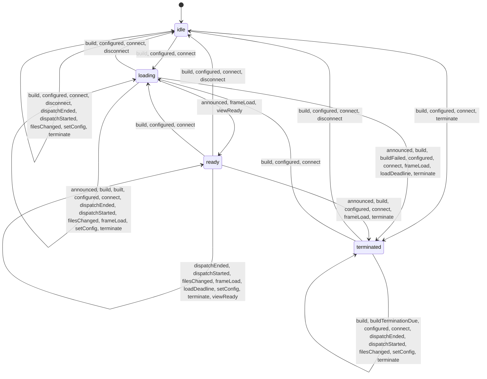

# Architecture

How `web-sandbox` is put together, on one page. It is the map; the [API reference](docs/API.md) is the surface, and the
decision records say why each part is built the way it is: [ADR-002](docs/ADR-002-host-guest-broker.md) (the broker),
[ADR-003](docs/ADR-003-lifecycle-and-liveness.md) (lifecycle and liveness), [ADR-004](docs/ADR-004-files-as-blob-urls.md)
(files), [ADR-005](docs/ADR-005-strict-mode.md) (strict mode), [ADR-006](docs/ADR-006-fetch-bridge.md) (the fetch bridge)
and [ADR-007](docs/ADR-007-typed-origins.md) (typed origins). What the design defends, and what it leaves to the
embedder and the browser, is the [threat model](docs/THREAT-MODEL.md).

The tables below are generated from the values the code declares (`bun run docs:gen`), so they cannot drift from it.
Each section of prose says which declarations it describes; when one changes, `bun run docs:check` fails until the
section has been read (see [CONTRIBUTING](CONTRIBUTING.md#generated-docs-and-their-markers)).

## Modes and realms

<!-- describes: realms sig:acaf -->

Guest content never runs in the host page's realm. The element builds a **wrapper** frame it owns (`frame-src 'none'`,
an inert base URL, no referrer) and puts the guest inside it, in a frame with an opaque origin and a Content-Security-Policy
that is one fixed template per mode, to which the embedder adds only exact origins ([ADR-007](docs/ADR-007-typed-origins.md)).
What differs between the three modes is which realm the guest's code runs in:

- **strict** (the default): in a worker. The frame around it, the view, runs one script, the library's own, admitted by its
  hash, and draws what the worker renders. No guest script ever runs in a document.
- **cooperative**: in the guest document, for content that cooperates, within a frozen list of documented limits.
- **worker**: in a worker spawned by a frame with no guest markup. Frozen, to be folded into strict mode.

In every mode, with `fetchBridge`, the element adds one more frame of its own beside the wrapper: the **bridge frame**,
hidden, with an opaque origin and no guest code, which makes each request the host decided, so no Service Worker or
`fetch` wrapper of the host page applies to it ([ADR-006](docs/ADR-006-fetch-bridge.md)).

Every bootstrap that runs in a document of the library's (the view's and the bridge frame's, the cooperative guest's,
worker mode's frame's) first checks that the document is the one the library built: an opaque origin, `about:srcdoc`,
the base `about:blank`, and not cross-origin isolated (`src/lib/environment-check.ts`, S74). If a check fails the bootstrap stays inert, tells the host
page, and the element ends the sandbox with the reason of that check.

Each realm is declared once, with the functions the library stringifies into it (a realm cannot import from the host's
bundle, so those functions close over nothing, and the tests scan their text).

<!-- generated:begin realms -->
| Realm | What it is | Guest code | Code stringified into it | Channels |
| :--- | :--- | :--- | :--- | :--- |
| `host` | The host page's window: the element, its listeners, and the host end of every port. | no | — | `announcement`, `logic-port`, `view-port`, `view-init`, `bridge-init`, `bridge-port` |
| `wrapper` | The sandbox frame's document (frame-documents.ts): it holds the guest frame or the strict view, and runs no script. | no | — | — |
| `cooperative` | Cooperative mode's guest document: the bootstrap, then the guest's markup and scripts. | yes | `inSandboxScript`, `createBroker`, `createSizeOf`, `inSandboxFiles`, `inSandboxImportMap`, `inSandboxMarkup`, `checkSandboxEnvironment` | `announcement`, `logic-port` |
| `worker-frame` | Worker mode's frame document: it spawns the guest's worker and announces its port; no guest code or markup. | no | `workerBootstrap`, `checkSandboxEnvironment` | `announcement`, `worker` |
| `worker` | Worker mode's guest worker: the globals allowlist and the bootstrap, then the guest's code. | yes | `inSandboxScript`, `createBroker`, `createSizeOf`, `inSandboxFiles`, `keepOnlyWorkerGlobals`, `removeWebAssembly` | `logic-port`, `worker` |
| `view` | Strict mode's view document: it renders the guest's markup, spawns the guest's worker, and runs no guest code. | no | `inSandboxFiles`, `inSandboxView`, `sanitizeRender`, `viewBudget`, `cssLoadBound`, `checkSandboxEnvironment` | `announcement`, `view-init`, `view-port`, `render-port`, `worker` |
| `strict-worker` | Strict mode's guest worker: the scope check, the globals allowlist, the bootstrap and the prelude, then the guest's entry. | yes | `inSandboxScript`, `createBroker`, `createSizeOf`, `inSandboxFiles`, `keepOnlyWorkerGlobals`, `assertEntryScoped`, `inStrictWorker` | `logic-port`, `render-port`, `worker` |
| `bridge-frame` | The fetch bridge's frame (bridge-frame.ts): a hidden frame of the element's with an opaque origin, which makes every request the host decided; no guest code or markup, and the guest has no handle on it. | no | `checkSandboxEnvironment`, `inBridgeFrame` | `announcement`, `bridge-init`, `bridge-port` |
<!-- generated:end -->

<!-- generated:begin stringified -->
| Function | Module | Realms |
| :--- | :--- | :--- |
| `inSandboxScript` | `src/lib/in-sandbox-script.ts` | `cooperative`, `worker`, `strict-worker` |
| `createBroker` | `src/lib/rpc.ts` | `cooperative`, `worker`, `strict-worker` |
| `createSizeOf` | `src/lib/structured-size.ts` | `cooperative`, `worker`, `strict-worker` |
| `inSandboxFiles` | `src/lib/in-sandbox-files.ts` | `cooperative`, `worker`, `strict-worker`, `view` |
| `inSandboxImportMap` | `src/lib/in-sandbox-files.ts` | `cooperative` |
| `inSandboxMarkup` | `src/lib/in-sandbox-files.ts` | `cooperative` |
| `keepOnlyWorkerGlobals` | `src/lib/worker-globals.ts` | `worker`, `strict-worker` |
| `removeWebAssembly` | `src/host.ts` | `worker` |
| `workerBootstrap` | `src/lib/worker-bootstrap.ts` | `worker-frame` |
| `assertEntryScoped` | `src/lib/in-sandbox-view.ts` | `strict-worker` |
| `inStrictWorker` | `src/lib/in-sandbox-view.ts` | `strict-worker` |
| `inSandboxView` | `src/lib/in-sandbox-view.ts` | `view` |
| `sanitizeRender` | `src/lib/in-sandbox-view.ts` | `view` |
| `viewBudget` | `src/lib/in-sandbox-view.ts` | `view` |
| `cssLoadBound` | `src/lib/in-sandbox-view.ts` | `view` |
| `checkSandboxEnvironment` | `src/lib/environment-check.ts` | `cooperative`, `worker-frame`, `view`, `bridge-frame` |
| `inBridgeFrame` | `src/lib/in-bridge-frame.ts` | `bridge-frame` |
<!-- generated:end -->

## Strict mode: the worker and the view

<!-- describes: realms, channel:view-port, channel:render-port, channel:view-init sig:acaff2f6377249d7 -->

Strict mode splits what a guest needs into two realms that cannot run each other's code. The **worker** has the guest's
logic and no DOM; it keeps only the globals an allowlist names, so a network API an engine forgot to police does not exist
there. The **view** has the DOM and none of the guest's code: it cleans the markup the worker asks to render, moves it into
its document, and enforces the view's budgets. They talk on the render port, which the host is not on, so the host's own code never
carries a render (the view's work still runs on the host page's thread where the browser places the view there, and is
bounded: [API.md](docs/API.md#the-views-cost-to-the-host-page)). The host talks to each on a port of its own, and watches the view for liveness always and
the worker's with `watchdogTimeout`. The guest can therefore draw but not script, and a flood of drawing is bounded where
it is applied. See [ADR-005](docs/ADR-005-strict-mode.md) and, for the render path,
[ADR-002](docs/ADR-002-host-guest-broker.md).

## Channels and frames

<!-- describes: channels, frames sig:c20484f0 -->

Realms talk on channels, and every message on them is a frame of a declared type. A frame is declared once, with the
channels it may cross, the realms at its ends, and for each field what bounds it. What a frame carries out of a guest
realm or the view is cut, checked or measured before it is posted, and the host checks it again on receipt, so the guest
chooses a value but never its size; so is what the bridge frame carries of a response the guest's target chose. The
stringified code writes the frame types as literals; a test keeps them equal to the declaration.

How a field is bounded:

- **not a string**: a number, a boolean, or nothing of the guest's.
- **constant**: a string of the library's, from a closed set.
- **cut**: a string the guest chose, cut to a fixed length before it is posted.
- **checked**: a value the guest chose, refused past a fixed size before anything is posted.
- **measured**: a snapshot, measured whole against a byte budget before it is posted.
- **host**: the host's own value, sent into a realm; the guest never chose it.

<!-- generated:begin channels -->
| Channel | Kind | Spoken in | What it is for | Frame types |
| :--- | :--- | :--- | :--- | :--- |
| `announcement` | window message | `host`, `cooperative`, `worker-frame`, `view`, `bridge-frame` | A library frame's message to the host page's window, before any port: the guest frame's one announcement (the logic port, or worker mode's refusal), and any bootstrap's refusal of an environment other than the one built. | 2 |
| `logic-port` | MessagePort | `host`, `cooperative`, `worker`, `strict-worker` | The host and the guest: calls both ways, execute(), liveness, and the guest bootstrap's lines and reports. | 9 |
| `view-port` | MessagePort | `host`, `view` | Strict mode: the host and the view, which runs no guest code; the view's check-in, reports and liveness. | 15 |
| `render-port` | MessagePort | `view`, `strict-worker` | Strict mode: the view and the guest's worker; the host is not on this path. | 7 |
| `view-init` | window message | `host`, `view` | Strict mode: the host hands the view its two ports, once per build. | 1 |
| `worker` | worker message | `worker-frame`, `worker`, `view`, `strict-worker` | A frame and the worker it spawned: the worker gets its ports, and worker mode's worker says it started. | 3 |
| `bridge-init` | window message | `host`, `bridge-frame` | The fetch bridge: the host hands the bridge's frame its port, once per build. | 1 |
| `bridge-port` | MessagePort | `host`, `bridge-frame` | The fetch bridge: the host and the bridge's frame, which makes every request the host decided; the guest is not on this path. | 8 |
<!-- generated:end -->

<!-- generated:begin frames -->
| Frame | Route | Fields (what bounds each) | Purpose |
| :--- | :--- | :--- | :--- |
| `SANDBOX_PORT` | `announcement`: cooperative, worker-frame → host | `refused` (constant) | The guest frame's announcement: the logic port, transferred; or why worker mode's worker could not start. |
| `ENVIRONMENT_REFUSED` | `announcement`: cooperative, worker-frame, view, bridge-frame → host | `refused` (constant) | A bootstrap found its document other than the one the library built (environment-check.ts) and stayed inert: the sandbox ends with the reason of the check that failed. No port. |
| `INIT_PORT` | `worker`: worker-frame → worker | — | Worker mode's frame hands its worker the logic port. |
| `WORKER_STARTED` | `worker`: worker → worker-frame | — | Worker mode's worker attached its port: the frame may announce it. |
| `INIT_VIEW` | `view-init`: host → view | `workerSource` (host), `entryDone` (host), `viewFiles` (host), `html` (host), `autoResize` (host), `allowAnimations` (host), `allowAutoplay` (host), `origins` (host) | The host hands the view the logic and view ports, at the wrapper's load, with what the build shows. |
| `INIT_WORKER` | `worker`: view → strict-worker | — | The view hands the guest's worker the logic port and the render port. |
| `EXECUTE` | `logic-port`: host → cooperative, worker, strict-worker | `code` (host) | execute(): code for the guest to run. |
| `PING` | `logic-port`: host → cooperative, worker, strict-worker | `n` (not a string) | A liveness probe of the host's: the watchdog's (n > 0) or workerExecutionTimeout's (n < 0). |
| `PONG` | `logic-port`: cooperative, worker, strict-worker → host | `n` (not a string) | The bootstrap's answer to a PING, before the broker: answering at all is the signal. |
| `RPC_REQ` | `logic-port`: cooperative, worker, strict-worker → host `logic-port`: host → cooperative, worker, strict-worker | `id` (not a string), `method` (checked), `args` (measured) | A call: bridge.call() from the guest, call() from the host. Built by requestFrame only (rpc.ts). |
| `RPC_RES` | `logic-port`: cooperative, worker, strict-worker → host `logic-port`: host → cooperative, worker, strict-worker | `id` (checked), `ok` (not a string), `value` (measured), `error` (cut), `code` (constant) | A call's answer, on the port its request came from. Built by resultFrame and refusalFrame only (rpc.ts). |
| `LOG` | `logic-port`: cooperative, worker, strict-worker → host | `level` (constant), `args` (measured), `own` (not a string) | A console line of the guest's, or one of the relay's own (`own`): sandbox-log. |
| `VIOLATION` | `logic-port`: cooperative, worker, strict-worker → host `view-port`: view → host | `directive` (cut), `blockedURI` (cut), `sourceFile` (cut), `lineNumber` (not a string), `columnNumber` (not a string) | A Content-Security-Policy violation report: violation. Labelled by the port it arrived on in strict mode. |
| `RESIZE` | `logic-port`: cooperative → host `view-port`: view → host | `height` (not a string) | The content's height, for autoResize: from cooperative mode's bootstrap, or strict mode's view. |
| `UNCAUGHT_PAST_BUDGET` | `logic-port`: worker, strict-worker → host `view-port`: view → host | — | The guest raised more uncaught errors and rejections in a second than their budget: the sandbox ends. |
| `VIEW_READY` | `view-port`: view → host | `width` (not a string), `height` (not a string), `stillStyleRefused` (not a string) | The view's check-in, its first frame: the strict build is ready. |
| `VIEW_PING` | `view-port`: host → view | `n` (not a string) | The view's liveness probe (VIEW_LIVENESS_TIMEOUT_MS). |
| `VIEW_PONG` | `view-port`: view → host | `n` (not a string) | The view's answer to a VIEW_PING. |
| `VIEW_WRITE` | `view-port`: host → view | `id` (host), `path` (host), `mime` (host), `bytes` (host) | A guest write the host recorded, for the view to show (a raster image gets a URL of its own there). |
| `VIEW_WRITTEN` | `view-port`: view → host | `id` (not a string) | The view shows the write: the guest may now be told it stands. |
| `VIEW_FIRST_OVERRUN` | `view-port`: view → host | — | An operation of the view overran VIEW_MAX_OPERATION_MS, with no other in the window: one host line an environment. |
| `VIEW_OVERRUN` | `view-port`: view → host | — | A second overrun within VIEW_OVERRUN_WINDOW_MS: the sandbox ends. |
| `GUEST_ERROR` | `view-port`: view → host | `message` (cut) | The entry failed to start, with its error text: the sandbox ends, and the text follows as a guest line. |
| `GUEST_UNCAUGHT` | `view-port`: view → host | `message` (cut) | A later uncaught error of the worker's that only the view can describe: a guest line. |
| `GUEST_TEXT_DROPPED` | `view-port`: view → host | — | The view dropped a guest error text past its per-second window: one warn line an environment. |
| `TRUSTED_TYPES_REFUSED` | `view-port`: view → host | — | The host page's trusted-types directive does not name the view's policy: the build ends. |
| `WORKER_REFUSED` | `view-port`: view → host | — | The host page's policy refuses the view's blob: worker: the build ends. |
| `VIEW_STARTED` | `render-port`: strict-worker → view | — | The worker's prelude holds the render port: the view revokes the worker's source URL. Always its first frame. |
| `VIEW_RENDER` | `render-port`: strict-worker → view | `html` (checked), `into` (checked) | sandboxView.render(): markup for the view to clean and show. |
| `VIEW_TEXT` | `render-port`: strict-worker → view | `into` (checked), `text` (checked) | sandboxView.text(): an element's text, as one text node. |
| `VIEW_SET` | `render-port`: strict-worker → view | `id` (checked), `value` (checked), `checked` (not a string), `focus` (not a string) | sandboxView.set(): a form control's value or checked state, or focus. |
| `VIEW_LISTEN` | `render-port`: strict-worker → view | `types` (constant) | The event types the worker's sandboxView.on() handlers listen to. |
| `VIEW_ACK` | `render-port`: view → strict-worker | `refused` (constant) | The view applied a flush of operations: the worker's next one may go. What it refused, by name. |
| `VIEW_EVENT` | `render-port`: view → strict-worker | `detail` (cut) | An event of a type the worker listens to, as a detail. |
| `BRIDGE_INIT` | `bridge-init`: host → bridge-frame | `maxBytes` (host) | The host hands the fetch bridge's frame its port, at the frame's load. |
| `BRIDGE_READY` | `bridge-port`: bridge-frame → host | — | The bridge frame's check-in, its first frame: the frame holds its port. None within LOAD_TIMEOUT_MS: the bridge refuses every request. |
| `BRIDGE_FETCH` | `bridge-port`: host → bridge-frame | `id` (host), `url` (host), `method` (host), `headers` (host), `body` (host) | A request the host checked (fetch-bridge.ts), for the frame to make with BRIDGE_REQUEST_OPTIONS. |
| `BRIDGE_PULL` | `bridge-port`: host → bridge-frame | `id` (host) | The bridge reads the next chunk of a response's body: one a pull. |
| `BRIDGE_ABORT` | `bridge-port`: host → bridge-frame | `id` (host) | The host ended a request (its timeout, a refusal, a teardown): the frame aborts its fetch. |
| `BRIDGE_HEAD` | `bridge-port`: bridge-frame → host | `id` (not a string), `responseType` (constant), `status` (not a string), `statusText` (checked), `headers` (checked), `hasBody` (not a string) | A response's head, as the frame received it: the host decides on it (a redirect, the declared length). |
| `BRIDGE_CHUNK` | `bridge-port`: bridge-frame → host | `id` (not a string), `chunk` (checked) | The next chunk of a response's body, in answer to a BRIDGE_PULL. |
| `BRIDGE_END` | `bridge-port`: bridge-frame → host | `id` (not a string) | A response's body ended. |
| `BRIDGE_ERROR` | `bridge-port`: bridge-frame → host | `id` (not a string), `code` (constant) | A request failed in the frame: the network or CORS, a head too large, or a Request the browser refused. |
<!-- generated:end -->

## The lifecycle: one reducer, one executor

<!-- describes: lifecycle:states, lifecycle:inputs, lifecycle:effects, lifecycle:transitions sig:204e6fd096ff4b6e -->

The element's `state` is not kept by the code that reacts to the DOM. Every platform callback, timer, embedder call and
build result is an **input** to one pure function, `reduce(state, input)`, which returns the next state and a list of
**effects**; the **executor** stores the state first and then applies the effects in order, so a listener always finds
the environment it is told about in place. This is what makes the rules checkable:

- one path, one predicate: every transition is a case of `reduce`, and nothing else computes a next state;
- an input that comes from a callback or timer carries the generation of the environment that armed it, and `reduce`
  drops one from an environment that is gone, with no effect: an old environment cannot act;
- the `ready` gate has one door: only `loading` reaches `ready`, together with the flush of what waited for it;
- each input declares where it comes from and the states and modes it can arrive in; `reduce` asserts that, the model
  runs check it, and the diagram below is drawn by exploring `reduce` over exactly those pairs.

The states: `idle` (no environment: the element is not in a document), `loading` (an environment is being built, and its
guest has not checked in), `ready` (the guest checked in; its document may still be loading) and `terminated` (the
environment is gone, with a reason). See [ADR-003](docs/ADR-003-lifecycle-and-liveness.md).

<!-- generated:begin lifecycle-states -->
| State | Inputs that can arrive in it |
| :--- | :--- |
| `idle` | `connect`, `disconnect`, `build`, `setConfig`, `configured`, `filesChanged`, `terminate`, `dispatchStarted`, `dispatchEnded` |
| `loading` | `connect`, `disconnect`, `build`, `setConfig`, `configured`, `filesChanged`, `built`, `buildFailed`, `terminate`, `loadDeadline`, `frameLoad`, `announced`, `viewReady`, `dispatchStarted`, `dispatchEnded` |
| `ready` | `connect`, `disconnect`, `build`, `setConfig`, `configured`, `filesChanged`, `terminate`, `loadDeadline`, `frameLoad`, `announced`, `viewReady`, `dispatchStarted`, `dispatchEnded` |
| `terminated` | `connect`, `disconnect`, `build`, `setConfig`, `configured`, `filesChanged`, `buildTerminationDue`, `terminate`, `dispatchStarted`, `dispatchEnded` |
<!-- generated:end -->

<!-- generated:begin lifecycle-diagram -->

<!-- generated:end -->

<!-- generated:begin lifecycle-inputs -->
| Input | From | Generation it carries | States it can arrive in | Modes | Fields |
| :--- | :--- | :--- | :--- | :--- | :--- |
| `connect` | connectedCallback | — | any | any | `ctx: BuildContext` |
| `disconnect` | disconnectedCallback, adoptedCallback | — | any | any | — |
| `build` | reset(), load() | — | any | any | `why: 'reset' \| 'load'`, `ctx: BuildContext` |
| `setConfig` | setConfig() | — | any | any | `same: boolean` |
| `configured` | the applyConfig effect | — | any | any | `refusal: string \| null`, `ctx: BuildContext` |
| `filesChanged` | registerFiles(), unregisterFiles(), commitGuestWrites() | — | any | any | — |
| `built` | the build effect | always | `loading` | any | `prepared: unknown` |
| `buildFailed` | the build or attach effect | always | `loading` | any | `reason: string` |
| `buildTerminationDue` | the task effect | always | `terminated` | any | — |
| `terminate` | terminate(), the element's own terminations, the executor | when armed in an environment | any | any | `reason: string`, `notices?: readonly Notice[]` |
| `loadDeadline` | the load deadline | always | `loading`, `ready` | any | — |
| `frameLoad` | the wrapper's load event | always | `loading`, `ready` | any | `stillOurs: boolean`, `guest: window \| null` |
| `announced` | the host page's message listener | always | `loading`, `ready` | `cooperative`, `worker` | `valid: boolean`, `refusal: string \| null`, `port: unknown`, `source: window` |
| `viewReady` | the view port's VIEW_READY | always | `loading`, `ready` | `strict` | `height: unknown`, `stillStyleRefused: boolean` |
| `dispatchStarted` | the executor | — | any | any | `reason: string` |
| `dispatchEnded` | the executor | — | any | any | — |
<!-- generated:end -->

<!-- generated:begin lifecycle-effects -->
| Effect | What it does | Fields |
| :--- | :--- | :--- |
| `teardown` | host.ts, `_teardown` without its generation and pending-termination lines, which are the reducer's | — |
| `discardWrites` | the guest writes' overlay is dropped | — |
| `applyConfig` | stores the clone (normaliseConfig), and answers with its refusal: then `configured` | — |
| `build` | prepares the build; then `built`, or `buildFailed` if it threw | — |
| `attach` | the prepared build becomes the element's | `prepared: unknown` |
| `startLoadDeadline` | arms the load deadline (LOAD_TIMEOUT_MS) | — |
| `stopLoadDeadline` | stops the load deadline | — |
| `sendInitView` | strict mode, at the wrapper's load: the view (`target`) gets its ports (`_setupStrictChannels`) | `target: window` |
| `openChannel` | cooperative and worker mode: the announced port, or none (`setupChannel`) | `port: unknown` |
| `closePort` | an announced port no build takes | `port: unknown` |
| `checkView` | the view's size and still-style warnings (R3-1) | `height: unknown`, `stillStyleRefused: boolean` |
| `flush` | what waited for `ready` goes to the port (`_flushQueues`) | — |
| `startWatchdogs` | the guest's and, in strict mode, the view's | — |
| `startAutoResize` | the resizer, in place for the reports buffered before the port | — |
| `warn` | a console warning | `text: string` |
| `warnForeignDocument` | once per element (CB7) | — |
| `dispatch` | one of the lifecycle's two events | `event: 'ready'` `event: 'terminated'`, `reason: string` |
| `notice` | a line, as 'sandbox-log' | `notice: Notice` |
| `step` | a nested step, synchronously | `input: LcInput` |
| `task` | a step in a task of its own | `input: LcInput` |
<!-- generated:end -->

## Budgets

<!-- describes: budgets:channels sig:8864 -->

Everything the guest can make the host page, the view or the network do goes through a **channel**, and every channel has
a bound in count, bytes and time. The surfaces a guest can reach are listed once (the egress table), each with how it is
handled; the bounds are listed once per channel (`CHANNEL_BUDGETS`), each naming the constants behind it in the limits
registry; a test fails on a surface that relays, budgets or caps and belongs to no channel. A bound that depends on the
platform (the view shares the host page's thread on Firefox, WebKit and Android) is stated as a bound, with the embedder's
way out: `terminate()`, or removing the element. One gap is open (owner, 2026-10-21: backlogged, not
mitigated now): on desktop Chromium the view's liveness ping ends a healthy sandbox on one long stall
([S79](docs/BACKLOG.md#s79)). The
tables are in the API reference: [Limits](docs/API.md#limits) and
[Budgets](docs/API.md#budgets).

## Module map

Each file of `src/` with the role its header comment gives.

<!-- generated:begin module-map -->
| Module | Role |
| :--- | :--- |
| `src/csp-directives.ts` | The capabilities (sandbox flags and Permissions Policy features) an embedder can grant the guest |
| `src/devtools.ts` | Logs one sandbox's `sandbox-log` lines to the host page's console, safely |
| `src/host.ts` | The `<web-sandbox>` custom element |
| `src/index.ts` | Public entry point of the package |
| `src/lib/auto-resize.ts` | Content auto-sizing, host side |
| `src/lib/bridge-frame.ts` | The fetch bridge's frame, host side |
| `src/lib/capabilities.ts` | Filtering of the capabilities an embedder lists: the allowed ones are kept, every other one dropped with a warning |
| `src/lib/config-schema.ts` | The config schema |
| `src/lib/connect-facts.ts` | What each engine does with a `connect-src` source, as one table |
| `src/lib/cookie-facts.ts` | Which cookies each engine sends with a request of the sandbox, as one table |
| `src/lib/css-references.ts` | URL references in CSS |
| `src/lib/egress.ts` | The egress table |
| `src/lib/element-events.ts` | The element's events |
| `src/lib/engine-ledger.ts` | The engine-difference ledger |
| `src/lib/environment-check.ts` | The environment check |
| `src/lib/environment.ts` | The resources of one environment, declared once |
| `src/lib/fetch-bridge.ts` | The host-mediated fetch bridge, host side |
| `src/lib/files.ts` | The host side of file delivery: path validation, the MIME table and the store that lives on the element |
| `src/lib/frame-documents.ts` | Builds the documents the sandbox is made of |
| `src/lib/frames.ts` | The frame table |
| `src/lib/guest-writes.ts` | Guest writes, host side: the overlay of one environment |
| `src/lib/host-csp.ts` | The host page's Content-Security-Policy, read once per page load when the embedder did not give it (`hostContentSecurityPolicy`; INHERITED_CONTEXT.cspFetch) |
| `src/lib/host-site.ts` | The host page's site for cookies: which hosts get the host site's cookies with a request of the sandbox |
| `src/lib/import-map.ts` | The guest's own import maps |
| `src/lib/in-bridge-frame.ts` | The fetch bridge's frame, frame side: the only code that performs a request of the bridge |
| `src/lib/in-sandbox-files.ts` | The guest side of the registered files, `sandboxFiles`, and of the guest writes |
| `src/lib/in-sandbox-script.ts` | The guest bootstrap of every mode |
| `src/lib/in-sandbox-view.ts` | Strict mode's view and worker prelude |
| `src/lib/inherited-context.ts` | The host page's context, as data |
| `src/lib/lifecycle-transitions.ts` | The transitions the lifecycle reducer can make |
| `src/lib/lifecycle.ts` | The lifecycle of `<web-sandbox>` as one pure reducer, and the executor that applies its effects |
| `src/lib/limits.ts` | The limits registry: every numeric bound the docs state, once, with its value, what it bounds and where it is enforced |
| `src/lib/load-kinds.ts` | Which file types each kind of load admits: the one table that both the policy and reference resolution read |
| `src/lib/long-timer.ts` | The one timer for a delay that a config or a caller chooses |
| `src/lib/markup-references.ts` | Markup references to registered files |
| `src/lib/markup-scripts.ts` | Finds whether guest markup asks to run script |
| `src/lib/module-specifiers.ts` | The module graph |
| `src/lib/origin.ts` | The one parser for an origin an embedder lists |
| `src/lib/presets.ts` | Presets: the scenarios the playground offers for manual testing, and the payloads and rules the regression specs run |
| `src/lib/rate-limit.ts` | The one rate limiter of the library's per-second limits that refuse |
| `src/lib/realms.ts` | The realms registry |
| `src/lib/reasons.ts` | The texts the element gives |
| `src/lib/rpc.ts` | β — a typed, bidirectional RPC broker that rides the MessageChannel already connecting host and guest |
| `src/lib/sandbox-log.ts` | The detail of the element's 'sandbox-log' event |
| `src/lib/srcset.ts` | The URLs of a `srcset` attribute |
| `src/lib/structured-size.ts` | The one measure of the byte budgets on log lines and RPC messages: how many bytes structured clone copies for a value |
| `src/lib/trusted-types.ts` | The element's HTML sinks on a host page that enforces Trusted Types |
| `src/lib/utils.ts` | Small helpers shared across the library |
| `src/lib/violation.ts` | CSP violation reports from the guest |
| `src/lib/watchdog.ts` | Liveness watchdog for one frame generation |
| `src/lib/worker-bootstrap.ts` | Worker mode's frame bootstrap: stringified and injected into the sandbox frame |
| `src/lib/worker-globals.ts` | What guest code may find on a worker's global object, in worker mode and in strict mode |
| `src/lib/csp/csp-generator.ts` | The guest policy: one template per mode, filled with the parsed origins (origins.ts) and the library's own sources |
| `src/lib/csp/host-connect.ts` | The host page's `connect-src`, as far as the library needs it |
| `src/lib/csp/host-trusted-types.ts` | The host page's Trusted Types directives, as far as the library needs them (INHERITED_CONTEXT.trustedTypesRequirement) |
| `src/lib/csp/origins.ts` | `origins`: what the embedder may open in the guest policy |
| `src/lib/csp/script-hash.ts` | The CSP hash-source of a script, computed synchronously on the host |
<!-- generated:end -->
