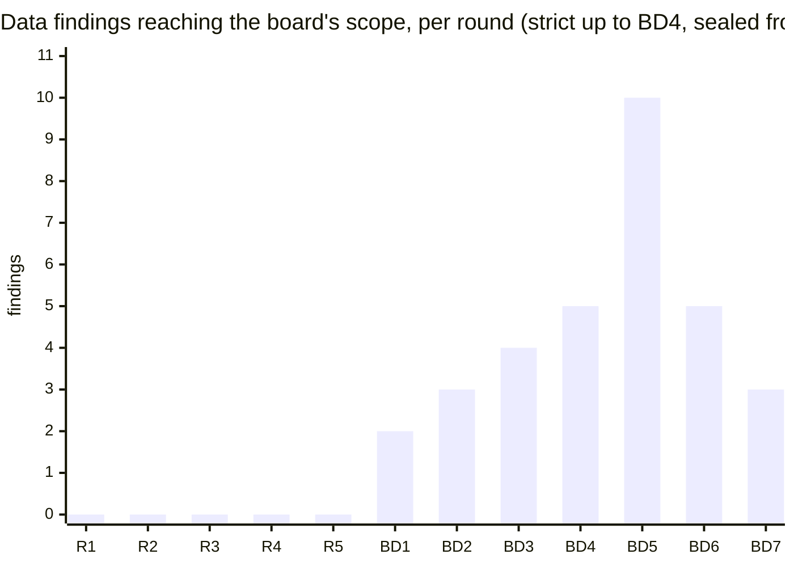

# 22. Review trajectory: is the finding curve bending?

Every review round since 2026-10-14, counted by what each finding could do, and the coordinator's evaluation of the
approach after each board pass. The data is [`rounds.json`](rounds.json) (one object per round, with the basis of every
count); the capabilities removed because of a finding are in [`clipped-capabilities.md`](clipped-capabilities.md). The
board's rule and its passes are backlog [S74](../../BACKLOG.md#s74); the reports are in
[the archive](../../archive/reviews/).

**How the counts are made.**
- A *data* finding leaks or can manipulate data, credentials or host state across the policy (the board's rule of
  2026-10-21, applied to the earlier rounds from their finding text). *Availability* findings cost time or memory only.
  *No data effect* covers docs, tests and correctness.
- *Reaching the scope* counts the data findings that reach the board's scope. Up to BD4 that is strict mode at its default
  configuration or with `origins` or `fetchBridge`. Strict mode became the default on 2026-10-15 (S48), so the four rounds
  before it have no such count. **From BD5 the scope is sealed mode** (the default since 2026-10-25, owner decision D5 of
  [research 24](../24_sealed_mode/README.md)): the BD5 value counts the data findings that reach sealed mode, with its own
  opt-ins, and a finding that reaches only strict's network opt-ins is not counted. The two populations are not the same
  (sealed has no network and a recipe of its own), so the BD5 value does not continue the strict series.
- The board passes (BD1 to BD7) had verifiers and added a docs reviewer, a test reviewer and a newcomer, so their low
  counts are higher and not comparable with R1 to R5. AR and BR used split ratings; the first-listed half is counted.

## The rounds

| Round | Date | Commit | Reviewers | High | Medium | Low | Data | Availability | No data effect | Data reaching the scope |
| :--- | :--- | :--- | :--- | ---: | ---: | ---: | ---: | ---: | ---: | ---: |
| AR, adversarial review | 2026-10-14 | `ca2110c` | 3 | 0 | 5 | 12 | 6 | 2 | 15 | n/a |
| FR, focused review | 2026-10-14 | `affe25e` | not stated | 1 | 2 | 3 | 2 | 2 | 8 | n/a |
| BR, broad review | 2026-10-14 | `12d7924` | 4 | 2 | 6 | 7 | 13 | 3 | 9 | n/a |
| VR, verification | 2026-10-14 | `8421d70` | 5 | 1 | 1 | 1 | 5 | 0 | 10 | n/a |
| R1 | 2026-10-15 | `5ede7ba` | 4 | 0 | 9 | 15 | 1 | 4 | 27 | 0 |
| R2 | 2026-10-15 | `31b8f0d` | 3 | 2 | 8 | 11 | 0 | 6 | 21 | 0 |
| R3 | 2026-10-18 | `16c545b` | 3 | 2 | 6 | 4 | 0 | 7 | 11 | 0 |
| R4 | 2026-10-18 | `c7672bb` | 3 | 0 | 5 | 7 | 0 | 5 | 15 | 0 |
| R5 | 2026-10-19 | `60814b5` | 3 | 1 | 6 | 7 | 0 | 6 | 10 | 0 |
| BD1, board pass 1 | 2026-10-21 | `9141e4e` | 6 + 3 verifiers | 4 | 5 | 43 | 3 | 5 | 45 | 2 |
| BD2, board pass 2 | 2026-10-21 | `6d727a8` | 6 + 3 verifiers | 3 | 9 | 17 | 5 | 2 | 22 | 3 |
| BD3, board pass 3 | 2026-10-23 | `be0a34a` | 6 + 2 verifiers | 4 | 6 | 28 | 5 | 1 | 32 | 4 |
| BD4, board pass 4 | 2026-10-24 | `46eb358` | 6 + 5 verifiers | 3 | 7 | 14 | 5 | 3 | 16 | 5 (strict) |
| BD5, board pass 5 | 2026-10-25 | `7f227db` | 6 + 3 verifiers | 1 | 7 | 16 | 10 | 1 | 13 | 10 (sealed) |
| BD6, board pass 6 | 2026-11-07 | `c404689` | 6 + 3 verifiers | 2 | 0 | 11 | 5 | 0 | 8 | 5 (sealed) |
| BD7, board pass 7 | 2026-11-07 | `fbc2587` | 6 + 2 verifiers | 3 | 2 | 11 | 3 | 2 | 11 | 3 (sealed) |

There was no critical finding in any round.

*Reaching the scope* for BD4 counts the five confirmed data findings: ISO-1, ISO-3, CHL-2, DOC-2 and DOC-3. Each was reproduced
by its reviewer and by a verifier on the three engines, and each needs an opt-in (`origins.connect` or
`origins.withoutCors`). CHL-1 (confirmed, medium) is not counted: no destination is reached that the guest could not reach
already, so it is a uniformity failure, not a leak; NEW-2 (a docs example whose sink is the embedder's code) has no
reproduction. Counted as data, they would make 7. The BD4 row has its duplicates (DOC-1, DOC-4) and its refuted finding
(LIM-2) taken out: 27 findings as filed, 24 after the verdicts.

*Reaching the scope* for BD5 counts the data findings that reach sealed mode: ISO-1, NEW-1, LIM-1, LIM-2 (with DOC-1),
DOC-2, DOC-3 (with CHL-1), CHL-2 and DOC-5 are confirmed (8), and DOC-6 and DOC-7 are the DOC reviewer's low docs gaps,
labelled data and unverified (2). Counting only the confirmed ones gives 8. None needs `origins` or `fetchBridge`. NEW-2
(a docs example that lost saves) and CHL-3 (a V8 stack hook, no data) are not counted. The BD5 row has its duplicate
(DOC-4) and its merges (CHL-1 into DOC-3, DOC-1 into LIM-2) taken out: 27 findings as filed, 24 after the verdicts. The
chart's BD5 bar is on the sealed basis.

*Reaching the scope* for BD6 counts the five confirmed data findings that reach sealed mode, all verified: ISO-1, ISO-2,
LIM-1 (with CHL-1), LIM-2 and CHL-3. None needs `origins` or `fetchBridge`. The other eight (CHL-2, DOC-1, DOC-2 with
CHL-4, DOC-3, DOC-4, TST-1, NEW-1, NEW-2) have no data effect. The BD6 row has its merges (CHL-1 into LIM-1, CHL-4 into
DOC-2) taken out: 15 findings as filed, 13 after the verdicts. BD6 is on the same sealed basis as BD5, so the two bars
compare.

*Reaching the scope* for BD7 counts the three confirmed data findings that reach sealed mode, all verified: LIM-1, ISO-1
and CHL-2. None needs `origins` or `fetchBridge`. The two availability findings (LIM-2, LIM-3) and the eleven findings
with no data effect (ISO-2 with CHL-1, ISO-3, LIM-4, LIM-5, DOC-1 to DOC-3, TST-1, TST-2, NEW-1, NEW-2) are not counted.
The BD7 row has its merge (CHL-1 into ISO-2) taken out: 17 findings as filed, 16 after the verdicts, with the verdicts'
ratings (ISO-1 raised from medium to high, CHL-2 from low to medium). BD7 is on the same sealed basis as BD5 and BD6, so
the three bars compare.

## What the curve says

**The rise is method first.** Data findings fell to zero across R2 to R5, which probed the library through the test
harness page, where the host page is plain. The board passes added a realistic host page (a strict CSP, Trusted Types,
cookies on sibling subdomains, consent scripts, frames) and a newcomer who embeds from the docs alone. Every data finding
since then is about the host page's context reaching the sandbox (classes A and E of
[research 18](../18_finding_classes/README.md)): its CSP, its base URL and its cookies.

**Then fix-induced.** The three confirmed highs of BD3 are in code written to fix BD2:

| Finding | Code | Added | What that code did |
| :--- | :--- | :--- | :--- |
| BD3:CHL-1 | `src/lib/host-csp.ts` | 2026-10-23 | Read the host page's `connect-src` with a decoy request; a moved element left the read without an answer, and the build kept every listed origin. |
| BD3:ISO-1 | `src/lib/host-site.ts` | 2026-10-22 | Learned the host's registrable domain by writing a test cookie; a host that holds back cookie writes made it guess, and the guess admitted siblings. |
| BD3:ISO-2 | the same-site decision in `src/host.ts` | 2026-10-22 | Took the host origin from `location`, which reads `'null'` in a same-origin `srcdoc`, so nothing counted as same-site. |

Each of them predicted something the browser decides (which policy applies, which cookies a request carries) from host
page state the library cannot verify, and admitted the origin when the prediction failed. A realistic-host review finds
the edges of every such predictor, and a patch on an edge adds more prediction code. The data count reaching strict went
2, 3, 4 while the core (the worker, the request gate, the view's allowlists, the environment check, the fetch bridge)
was found sound by every reviewer of BD2 and BD3.

**The response (2026-10-24).** Replace a prediction with a rule that reads only what the browser guarantees and refuses
when it cannot decide, and delete the predictor: the host page's site from `self.origin` by one rule that can only
over-refuse, and a host-policy read that never answers "absent" (both in #71). Cookies on the strict view's loads go the
same way: the renderer forces `crossorigin="anonymous"`, so the browser omits them
([research 21](../21_crossorigin_loads/README.md)).

**Pass 4 found the response incomplete, and in the same places.** The count reaching strict rose to 5, and the three
highs sit in #71's code and its neighbours:

| Finding | Code | Added | What that code did |
| :--- | :--- | :--- | :--- |
| BD4:ISO-1, BD4:ISO-3 | `src/lib/host-site.ts` | #71 | Decided the host page's site from the realm's `self.origin`. An opaque origin meant "no site", so every entry was kept; and the browser decides a request's site from the top-level document (WebKit) or an ancestor, so a host page framed by another site, or sandboxed, kept entries on a site that WebKit sends Lax and Strict cookies to. |
| BD4:CHL-2 | `src/lib/host-csp.ts` | #71 | Read the host page's `connect-src` through a decoy within 2 s and cached "cannot be read" for the page; a stall of the host's thread made every later build keep its connect lists. |
| BD4:DOC-2, BD4:DOC-3 | `origins.withoutCors` | #73 | A per-origin exception to the forced `crossorigin`. It was approved while the guest could not read a load's result; the readback of #74 made it a credentialed read, and a redirect or an imported sheet carried the cookie to the other listed origins. |

The pattern is the one of pass 3: a prediction of a browser decision (which site, which policy, which cookie) from state
the library cannot verify, plus an exception to a construction that held. This time the response removes the predictors
instead of correcting them (2026-10-24): strict mode has no cookie carrier, no `WebSocket` and no `origins.withoutCors`
(#75); the host page's policy comes only from `hostContentSecurityPolicy` and the read is deleted (#76); the same-site rule
refuses whenever it cannot decide, and counts every ancestor's site (#78). And the board's scope changes: sealed mode, strict
with no network, becomes the default and the scope (D5 of [research 24](../24_sealed_mode/README.md)), so a network opt-in
of strict is no longer where a clean pass is decided.

**Pass 5 found the library's isolation sound and the hand-over wide.** The scope changed to sealed mode, and the bar for
BD5 is on that basis (10, of which 8 verified). The one finding in the isolation itself is ISO-1: a sealed guest on WebKit
read the host origin's permission grants through `navigator.permissions`, an allowlisted member of the worker whose answer
depends on the host's origin. Everything else is where the host and the app exchange values, or where the docs tell the
embedder what to do with them:

| Finding | Code or text | Added | What it did |
| :--- | :--- | :--- | :--- |
| BD5:NEW-1, BD5:DOC-3 (with CHL-1), BD5:CHL-2, BD5:DOC-5, BD5:DOC-6, BD5:DOC-7 | the sealed-app recipe and `examples/sealed-app` | #84 | The `openExternal` guard admitted any path and query of a listed origin; the example saved every app's bundle under one key and an exposed method outlived its app; the docs said nothing about an object URL of the app's bytes, told the embedder to run the app's WebAssembly in the page, and left the commit of validated writes and the meaning of a type open. |
| BD5:LIM-1, BD5:LIM-2 (with DOC-1) | `src/lib/rpc.ts`, the broker | earlier rounds | A typed-array view crossed with its whole buffer, and a failed host method's engine text crossed to the app: what crosses was not what the API showed. |
| BD5:DOC-2 | the `terminated` reasons | earlier rounds | The reason quoted the entry and the mode, which an embedder may take from the app's bundle. |

Six of the ten sit in the recipe and example that the previous round added, so the evaluation rule triggered in its second
form (a pass's data findings sit in code that the previous round added). The class moved from "the library predicts
host-page state" (A and E, passes 1 to 4) to "the host to app API hands over more than intended" (P, and docs gaps at the
API's output boundary). The response is by construction where the library could do it: a view crosses with its own bytes
and only the embedder's words reach the app from a failed host method (#86), `unexpose()` removes a method (#86), the
worker has no `permissions` or `storage`, every generated source is strict-mode code and a reason never quotes a
configured value (#87); and in the docs where only the embedder can (the pass-5 docs and test batch): links by key,
state per app, one element per app, no URL from the app's bytes, and why the app's WebAssembly never runs in the page.

**Pass 6: the count fell, with one new channel and two returning classes.** On the same sealed basis the count went from 10
to 5, and the two highs are the first findings in sealed mode's isolation since BD5:ISO-1. They are one channel that
`INHERITED_CONTEXT` had no row for: a sandbox's frames and workers inherit the host page's whole policy list, and every
refusing check of it reports the policy's text to the guest (`originalPolicy`, the engine's `EvalError` text) and the
guest's strings and URLs to the host's `report-uri`. That is class A again, as a whole channel and not an instance, and it
is not fix-induced. The other three sit where earlier fixes left a gap:

| Finding | Code | Added | What that code did |
| :--- | :--- | :--- | :--- |
| BD6:LIM-1 (with CHL-1) | `src/lib/rpc.ts`, `request()` and `handlerErrorText` | #86 | The pass-5 rule "only the embedder's words cross" counted the library's own refusal of an argument it could not copy as the embedder's, because it was a plain host `Error` that carried the engine's text. |
| BD6:LIM-2, BD6:CHL-3 | `examples/sealed-app/host.js` and its docs | #88 | One element for several apps, with a `stop()` that cleared the methods and files and not the pending writes or the handles a host method holds; a failed load returned no `stop()`. |

The response is by construction. The worker never reaches a refusing check (the library's `EvalError` replaces the
platform's before the entry runs, an entry cannot spell `import(`, sealed mode refuses `scriptUnsafe` and so has no
`execute()`, violation events are stopped after the relay and read blank, the view runs no guest code), and the view's
guest styles go through the CSSOM, where no `style-src` applies (#90 and the CSSOM fix); the library's own refusals have
fixed texts, and a `WeakSet` of the errors it made is what a handler forwards (#89); and an element is one app's for its
life, which the recipe builds in (this pull request). Two rows are added to the clipped-capabilities list: sealed mode's
`execute()` and `scriptUnsafe`, and `import()` in an entry.

**Pass 6: the drift check, and class A closed by enumeration.** Pass 6's two highs (BD6:ISO-1, BD6:ISO-2: the host page's
policy text and report endpoints, reached from the sealed worker through `eval`, `import()` and the violation event) are
class A again, after BD5:ISO-1 (permission state) in pass 5 and the host-adaptation findings of pass 4: each time through a
channel the `INHERITED_CONTEXT` list did not have yet, and each fix added a row. That is the drift the project's rule names
(the same class of problem coming back after each fix), so the response did not stop at the rows: the inherited context is
a list of bad cases, and the classes that closed were closed by a list of allowed ones with a test that enumerates the
domain ([research 18](../18_finding_classes/README.md#class-a-closed-by-enumeration)). In sealed mode the domain is
finite: the worker's allowlist and the renderer's. `SEALED_REACH` classifies every name of both against every row, the
unit test keeps a new name or a new row from shipping unclassified, and the e2e sweep calls every member of every kept
global on the realistic host on three engines. The enumeration found two things no pass had, and both were closed by
construction: a row the list lacked (the host page's secure context, which Firefox's and WebKit's sealed worker followed,
one bit; the worker now keeps nothing only a secure context has and reads `isSecureContext` as false, Chromium's surface on
every engine, and the comparison of the two kinds of host page fails on any difference) and a name it called neutralised
that was not (a refused `XMLHttpRequest` that a throwing `open()` left sendable, which Chromium reported to the page's
endpoint; closed in the request gate). Deconstructed to the root, neither needed the owner: the first is one surface for
every engine and host page, the second a state the gate cannot reach.

**Pass 7: the count fell again, and the findings sit at the edges of the enumeration.** On the same sealed basis the count
went from 5 to 3. The enumeration of pass 6 did what it was built for: the ISO reviewer's re-read of the worker's allowlist,
the code-from-string refusal and the request gate found nothing, and no reviewer forged a frame or reached the network from
a newcomer's app. The three data findings are where the enumeration's domain ended:

| Finding | Code | Added | What that code did |
| :--- | :--- | :--- | :--- |
| BD7:LIM-1 | `src/host.ts`, `_warnAboutStrictHtml` and `parseInert` | the strict-mode warning | Parsed the app's config `html` with the host realm's `DOMParser`, so the browser checked the guest's styles and `<base>` against the host page's own policy and reported them. The enumeration listed what a guest can reach in its own realms (the worker, the view), and the host realm, where the library handles guest content, was not a reach path. |
| BD7:ISO-1 | `src/lib/css-references.ts`, `isNetwork` | the CSS scanner; its claim made false by #93 | Kept every URL in guest CSS that was not a server URL: a list of bad schemes next to markup's list of allowed URLs. The browser checks every URL it loads, so a `data:`, custom or unminted `blob:` URL was reported to the host's endpoint, with a scheme the guest chose. #93 changed the `cspReporting` cells for styles from `remains` to `neutralised`, which this finding falsifies. |
| BD7:CHL-2 | `src/lib/rpc.ts`, `handlerErrorText`, and the library's errors | #89 | The fixed-text rule of BD6:LIM-1 held for the refusals it listed; the library's other errors were plain `Error`s whose messages interpolate the caller's path, a method name or another app's text, and `handlerErrorText` forwarded them. |

LIM-2 (the entry scan is quadratic), LIM-4 and LIM-5 sit in code that the pass-6 fixes added or changed (#90 and #93).
So the evaluation rule triggered in its second form for CHL-2 and for those three, and not in its first: the count fell for
the second time in a row (10, 5, 3).

**The drift check, after pass 7.** The signs the project's rule names are a fix that moves a symptom, a follow-up to a
follow-up, and the same class coming back. Read against the record:
- **The architecture has held since sealed mode.** No fix has been reverted; the channel layer held three passes in a row
  (BD5 to BD7), the worker's surface held, and the pass-7 findings are in the host realm, the view's URL rule and the
  library's own error texts, not in the sealed construction (a worker and an inert view with no network).
- **The code grew.** `src/` went from 16.7k lines at pass 1 to 23.0k at pass 7 (+38%), and the largest growth is in fix
  pull requests: #92 added 893 lines, #90 384 and #93 311. Each fix by construction adds the construction (a table, a
  scan, a registry) and its tests, and a pass then finds the next edge of the construction. Of the 23.7k lines at the
  head of pass 7's fixes, about 2.7k are data registries that only the tests and the docs read (`SEALED_REACH`,
  `INHERITED_CONTEXT`, `HOST_PASSES`, the engine ledger, the presets, the lifecycle transitions): no module the library
  runs imports them. They are the enumerated domains the board's rule asks for; the code the library runs is about 21.0k
  lines.
- **Class A came back a fifth pass** (passes 3 to 7), at a new boundary each time: the host page's site and policy (passes 3
  and 4), permission state (pass 5), the policy text and reporting endpoints reached from the worker (pass 6), and in pass 7
  the host realm's own handling of guest content and a deny-list of schemes in CSS. Each time the fix closed the channel
  and the next pass found a neighbour. That is the pattern the rule names, and the response to it is the one of pass 6: a
  list of allowed cases and a test that enumerates the domain. Pass 7 shows that the domain was drawn too narrowly (two
  realms, and not the third; one URL rule in markup, and not in CSS), and the fixes redraw it: a registry of the host's passes
  over guest content, and one keep-predicate for every URL.

**The subtraction pass before pass 8.** The plan was to remove what the pass-6 and pass-7 fixes made redundant before the
board looks again. The inventory (at the head of pass 7's fixes, the URL-rule fix included) found little to remove. Every
layer beside a chokepoint is either an independent mechanism kept on purpose (the browser's CSP under the request gate and
the URL keep-predicate; the view's load budget, which research 18's rule B5 keeps independent of the renderer's model) or a
small duplicate. The internal removals come to about 190 lines, 58 of them in `src/` (a WebAssembly removal step that the
worker allowlist already covers, two once-per-element warning sets, a guard the broker's types rule out, an alias of the
forced-attribute table); the rest are unit tests that are special cases of the URL keep-rule's enumeration. So the growth
is the constructions and their registries, not layers left behind. The large removals would be public features outside
the board's scope, cooperative and worker modes (roughly 2k lines, not traced) and strict mode's network options (about
1.9k), which is a decision for the owner. Pass 8 reviews sealed mode again after the internal removals.

**The open question for the owner (D6).**
<!-- owner-question:begin -->
The question pending the owner's answer: keep D6 (the served-document mode of [research 20](../20_served_document_mode/README.md)
shelved, [research 24](../24_sealed_mode/README.md)) with a trigger, so that if pass 8 finds another class-A data finding
through the inherited policy, sealed mode switches to served documents, or switch now. The served-document mode removes the
inherited policy by construction (its documents are served by the embedder with their own headers and start a policy container of
their own, and the guests' `srcdoc` frames inherit that one), at the cost the research measures: the embedder serves one
static file. Pending the owner's answer: no decision has been taken, and pass 8 reviews sealed mode as it is.
<!-- owner-question:end -->

## What capability it has cost

52 capabilities were removed or restricted because of a finding ([the table](clipped-capabilities.md)). What a UI author
notices most: the strict view renders an allowlist (no `canvas`, SVG filters or animation, popovers or `contenteditable`;
links and forms navigate nowhere); CSS animations and transitions and autoplay are opt-ins; the network is typed exact
origins with credentials omitted; the worker keeps an allowlist of globals, and since BD5 that list holds neither `navigator.permissions` nor
`navigator.storage`; after BD6 the strict and sealed worker holds nothing only a secure context has (no `crypto.subtle`,
Web Locks or WebCodecs coders), which Chromium's never had.

The fixes of BD3 cost network convenience, not UI: listed image, media and style origins must answer CORS; other sites
under a multi-label public suffix (two `github.io` sites) are refused; network `url()` in guest CSS is dropped in strict
mode. The fixes of BD4 cost more of it: strict mode opens no `WebSocket` and has no per-origin way around CORS for a view
load, and an embedder that lists `connect` or bridge origins passes its page's policy as text. The finding classes left
open (the value boundary, re-entry, the shared thread) are internal and cost no capability.

**Strict mode and a modern UI.** It carries forms, dashboards, app shells and settings flows with CSS transitions (the
`allowAnimations` opt-in), and, since pointer, wheel, scroll and focus events reach the worker (#74,
[research 23](../23_view_input/README.md)), drag-and-drop, gestures, custom sliders and virtual scrolling, all of it guest
code in the worker and none in the view.

## The evaluation rule

After every board pass the coordinator updates this note and S74, and changes the approach before the next pass when
either holds:
- the data findings reaching the board's scope do not fall for two passes in a row;
- a pass's data findings sit in code that the previous pass's fixes added.

"Change the approach" means shrinking the surface the finding came from (deleting a predictor, constructing a property
instead of checking it, or the served-document mode, which removes most of the host-adaptation layer) rather than
patching it.

## Evaluations

| After | Data reaching the scope | Rule triggered | Decision |
| :--- | ---: | :--- | :--- |
| BD3 (2026-10-24) | 4 (up from 3) | both: the count rose a second time, and all three highs sit in code BD2's fixes added | Delete the two predictors (#71); cookies on view loads by `crossorigin="anonymous"`; pass 4 reviews the result. If pass 4 still finds host-adaptation data findings, take up the served-document mode. |
| BD4 (2026-10-24) | 5 (up from 4) | both again: the count rose a third time, and the three highs (BD4:ISO-1, BD4:ISO-3, BD4:CHL-2) sit in #71's code (`host-site.ts`, `host-csp.ts`); BD4:DOC-2 and BD4:DOC-3 sit in the exception of #73 | Owner, 2026-10-24: sealed mode becomes the default and the board's scope, and strict's network findings no longer block a clean pass (D5). The predictors are deleted: the cookie carriers (#75), the policy read (#76) and the same-site rule's guesses (#78). Pass 5 reviews sealed mode at its default. |
| BD6, class A (2026-11-07) | both highs (BD6:ISO-1, BD6:ISO-2) reach sealed mode and are class A | the first form for class A: its data findings did not fall across passes 4, 5 and 6, each through a new channel; the drift check named it | Class A is closed by enumeration instead of by rows (above, and [research 18](../18_finding_classes/README.md#class-a-closed-by-enumeration)): every name a sealed guest can reach is classified against every inherited row (`SEALED_REACH`), with a unit test that fails on an unclassified name or row and an e2e sweep of every member on three engines. It found the `secureContext` row (closed by construction: the strict and sealed worker keeps nothing only a secure context has and reads `isSecureContext` as false, the same surface on every engine and host page) and a request-gate state that let a refused `XMLHttpRequest` reach the platform (fixed by construction). Pass 7 reviews sealed mode with the table in place. |
| BD5 (2026-10-25) | 10 reach sealed, the new scope (8 verified); not comparable with the strict series | the second form: most findings (NEW-1, DOC-3 with CHL-1, CHL-2, DOC-5, DOC-6, DOC-7) sit in the recipe and example that #84 added to the previous round; the count did not fall | Sealed mode's isolation held: no network on any engine under mutation testing and 172 extra constructs, no forged frame, and one host-state read (BD5:ISO-1, WebKit permissions). The class moved from "the library predicts host-page state" to "the host to app API hands over more than intended". By construction where the library can (#86: a view crosses with its own bytes, only the embedder's words from a failed host method, `unexpose()`; #87: no `permissions` or `storage` in the worker, strict-mode generated sources, no echo in reasons), and in the docs where only the embedder can (the pass-5 docs and test batch). Pass 6 reviews sealed mode again. |
| BD6 (2026-11-07) | 5 reach sealed (down from 10 on the same basis: it fell); all 5 verified | the second form, for 3 of the 5: LIM-2 and CHL-3 sit in the recipe that #88 rewrote, and LIM-1 in an incomplete part of #86's error-text rule. The count fell, so the first condition does not hold. ISO-1 and ISO-2 are a new channel and not fix-induced | No owner decision. By construction: the worker never reaches a refusing check of the host page's policy and the view's guest styles go through the CSSOM (class A: `cspPolicyText`, `cspReporting`; #90 and the CSSOM fix); the library's own refusals carry fixed texts (#89); an element is one app's for its life, and the recipe makes one for each mount (this pull request). The served-document mode is not taken up: it was the ISO reviewer's only full construction for ISO-2, and the worker's removal of every refusing check reaches the same result without it. Pass 7 reviews sealed mode again. |
| BD7 (2026-11-07) | 3 reach sealed (down from 5 on the same basis: it fell, a second time); all 3 verified | the second form, for CHL-2 (the fix of #89 left the library's other errors forwarding their messages) and for LIM-2, LIM-4 and LIM-5 (the code of #90 and #93). The count fell, so the first condition does not hold | No owner decision for the findings. By construction: no HTML parser in the host realm on a strict or sealed build, one registry of the host's passes over guest content (each pure and linear, with a scaling test), every standalone `import` token refused and `html` capped (the host-realm passes fix); a library error crosses as its code's fixed text from one table, made by one factory (the crossing-texts fix); one keep-predicate for URLs in markup and CSS, only URLs the view minted (a fragment only in an SVG reference), with `disablepictureinpicture` and `disableremoteplayback` forced (the URL-rule fix); and the docs fix. A subtraction pass comes before pass 8, which reviews sealed mode again. **Open: whether to keep D6 (the served-document mode shelved) with a trigger or switch now, pending the owner's answer (above).** |
