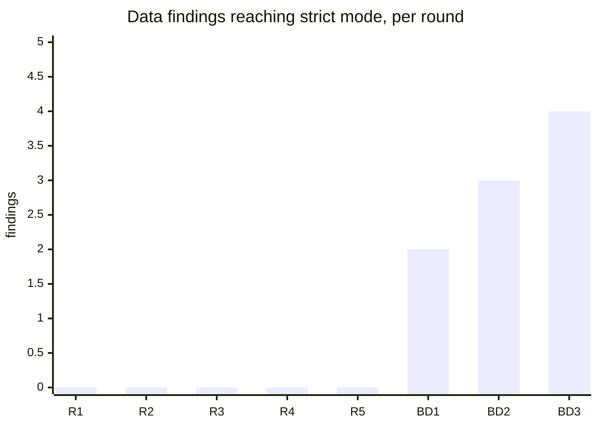

# 22. Review trajectory: is the finding curve bending?

Every review round since 2026-10-14, counted by what each finding could do, and the coordinator's evaluation of the
approach after each board pass. The data is [`rounds.json`](rounds.json) (one object per round, with the basis of every
count); the capabilities removed because of a finding are in [`clipped-capabilities.md`](clipped-capabilities.md). The
board's rule and its passes are backlog [S74](../../BACKLOG.md#s74); the reports are in
[the archive](../../archive/reviews/).

**How the counts are made.**
- A *data* finding leaks or can manipulate data, credentials or host state across the policy (the board's rule of
  2026-10-21, applied to the earlier rounds from their finding text). *Availability* findings cost time or memory only.
  *No data effect* covers docs, tests and correctness.
- *Reaching strict* counts the data findings that reach strict mode at its default configuration or with `origins` or
  `fetchBridge`. Strict mode became the default on 2026-10-15 (S48), so the four rounds before it have no such count.
- The board passes (BD1 to BD3) had verifiers and added a docs reviewer, a test reviewer and a newcomer, so their low
  counts are higher and not comparable with R1 to R5. AR and BR used split ratings; the first-listed half is counted.

## The rounds

| Round | Date | Commit | Reviewers | High | Medium | Low | Data | Availability | No data effect | Data reaching strict |
| :--- | :--- | :--- | :--- | ---: | ---: | ---: | ---: | ---: | ---: | ---: |
| AR, adversarial review | 2026-10-14 | `ca2110c` | 3 | 0 | 5 | 12 | 6 | 2 | 15 | n/a |
| FR, focused review | 2026-10-14 | `affe25e` | not stated | 1 | 2 | 3 | 2 | 2 | 8 | n/a |
| BR, broad review | 2026-10-14 | `12d7924` | 4 | 2 | 6 | 7 | 13 | 3 | 9 | n/a |
| VR, verification | 2026-10-14 | `8421d70` | 5 | 1 | 1 | 1 | 5 | 0 | 10 | n/a |
| R1 | 2026-10-15 | `5ede7ba` | 4 | 0 | 9 | 15 | 1 | 4 | 27 | 0 |
| R2 | 2026-10-15 | `31b8f0d` | 3 | 2 | 8 | 11 | 0 | 6 | 21 | 0 |
| R3 | 2026-10-18 | `16c545b` | 3 | 2 | 6 | 4 | 0 | 7 | 11 | 0 |
| R4 | 2026-10-18 | `c7672bb` | 3 | 0 | 5 | 7 | 0 | 5 | 15 | 0 |
| R5 | 2026-10-19 | `60814b5` | 3 | 1 | 6 | 7 | 0 | 6 | 10 | 0 |
| BD1, board pass 1 | 2026-10-21 | `9141e4e` | 6 + 3 verifiers | 4 | 5 | 43 | 3 | 5 | 45 | 2 |
| BD2, board pass 2 | 2026-10-21 | `6d727a8` | 6 + 3 verifiers | 3 | 9 | 17 | 5 | 2 | 22 | 3 |
| BD3, board pass 3 | 2026-10-23 | `be0a34a` | 6 + 2 verifiers | 4 | 6 | 28 | 5 | 1 | 32 | 4 |

There was no critical finding in any round.

## What the curve says

**The rise is method first.** Data findings fell to zero across R2 to R5, which probed the library through the test
harness page, where the host page is plain. The board passes added a realistic host page (a strict CSP, Trusted Types,
cookies on sibling subdomains, consent scripts, frames) and a newcomer who embeds from the docs alone. Every data finding
since then is about the host page's context reaching the sandbox (classes A and E of
[research 18](../18_finding_classes/README.md)): its CSP, its base URL and its cookies.

**Then fix-induced.** The three confirmed highs of BD3 are in code written to fix BD2:

| Finding | Code | Added | What that code did |
| :--- | :--- | :--- | :--- |
| BD3:CHL-1 | `src/lib/host-csp.ts` | 2026-10-23 | Read the host page's `connect-src` with a decoy request; a moved element left the read without an answer, and the build kept every listed origin. |
| BD3:ISO-1 | `src/lib/host-site.ts` | 2026-10-22 | Learned the host's registrable domain by writing a test cookie; a host that holds back cookie writes made it guess, and the guess admitted siblings. |
| BD3:ISO-2 | the same-site decision in `src/host.ts` | 2026-10-22 | Took the host origin from `location`, which reads `'null'` in a same-origin `srcdoc`, so nothing counted as same-site. |

Each of them predicted something the browser decides (which policy applies, which cookies a request carries) from host
page state the library cannot verify, and admitted the origin when the prediction failed. A realistic-host review finds
the edges of every such predictor, and a patch on an edge adds more prediction code. The data count reaching strict went
2, 3, 4 while the core (the worker, the request gate, the view's allowlists, the environment check, the fetch bridge)
was found sound by every reviewer of BD2 and BD3.

**The response (2026-10-24).** Replace a prediction with a rule that reads only what the browser guarantees and refuses
when it cannot decide, and delete the predictor: the host page's site from `self.origin` by one rule that can only
over-refuse, and a host-policy read that never answers "absent" (both in #71). Cookies on the strict view's loads go the
same way: the renderer forces `crossorigin="anonymous"`, so the browser omits them
([research 21](../21_crossorigin_loads/README.md)).

## What capability it has cost

46 capabilities were removed or restricted because of a finding ([the table](clipped-capabilities.md)). What a UI author
notices most: the strict view renders an allowlist (no `canvas`, SVG filters or animation, popovers or `contenteditable`;
links and forms navigate nowhere); CSS animations and transitions and autoplay are opt-ins; the network is typed exact
origins with credentials omitted; the worker keeps an allowlist of globals.

The fixes of BD3 cost network convenience, not UI: listed image, media and style origins must answer CORS; other sites
under a multi-label public suffix (two `github.io` sites) are refused; network `url()` in guest CSS is dropped in strict
mode. The finding classes left open (the value boundary, re-entry, the shared thread) are internal and cost no
capability.

**Strict mode and a modern UI.** It carries forms, dashboards, app shells and settings flows with CSS transitions (the
`allowAnimations` opt-in). Until pointer, wheel, scroll and focus events reach the worker, it does not carry
drag-and-drop, gestures, custom sliders or virtual scrolling; that work was approved on 2026-10-24 and adds capability
back without guest code in the view.

## The evaluation rule

After every board pass the coordinator updates this note and S74, and changes the approach before the next pass when
either holds:
- the data findings reaching strict do not fall for two passes in a row;
- a pass's data findings sit in code that the previous pass's fixes added.

"Change the approach" means shrinking the surface the finding came from (deleting a predictor, constructing a property
instead of checking it, or the served-document mode, which removes most of the host-adaptation layer) rather than
patching it.

## Evaluations

| After | Data reaching strict | Rule triggered | Decision |
| :--- | ---: | :--- | :--- |
| BD3 (2026-10-24) | 4 (up from 3) | both: the count rose a second time, and all three highs sit in code BD2's fixes added | Delete the two predictors (#71); cookies on view loads by `crossorigin="anonymous"`; pass 4 reviews the result. If pass 4 still finds host-adaptation data findings, take up the served-document mode. |
